[简体中文](README.md) | [繁體中文](README.zh-TW.md) | **[English](README.en.md) (current)** | [日本語](README.ja.md)

<p align="center">
  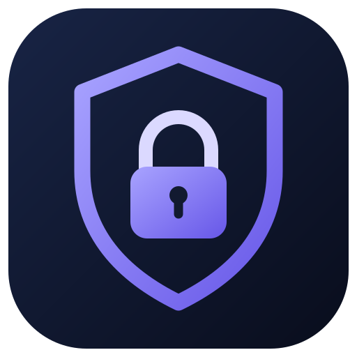
</p>

<h1 align="center">AUTHENTICATOR DESK</h1>

<p align="center">
  An offline-first Windows desktop authenticator for TOTP and HOTP codes.
  <br />
  Keep the vault local and the trust boundary clear.
</p>

<p align="center">
  <a href="https://github.com/yuchen0x1/authenticator-desk/releases/latest"></a>
  <a href="https://github.com/yuchen0x1/authenticator-desk/actions/workflows/ci.yml"></a>
  <a href="LICENSE"></a>
  <a href="https://github.com/yuchen0x1/authenticator-desk/stargazers"></a>
  <a href="https://github.com/yuchen0x1/authenticator-desk/network/members"></a>
</p>

<p align="center">
  <a href="https://github.com/yuchen0x1/authenticator-desk/releases/latest">Download the latest Windows release</a>
  ·
  <a href="docs/security-model.md">Security model</a>
  ·
  <a href="docs/test-report.md">Verification evidence</a>
  ·
  <a href="https://github.com/yuchen0x1/authenticator-desk/issues">Report an issue</a>
</p>

> **Published release:** [v0.3.1](https://github.com/yuchen0x1/authenticator-desk/releases/tag/v0.3.1), built from the tagged commit `7ae5151e3041487f9e46ac4cec943fbd20553daf`. The installers and verification evidence refer to that published release, not a new build from this documentation change.
> The release page contains NSIS (`.exe`) and MSI installers, detached update signatures, checksums and `update.json`.

## Why AUTHENTICATOR DESK?

AUTHENTICATOR DESK is for people who want to keep their second-factor accounts on a device they control, rather than in a hosted account service. It uses a local encrypted vault and does not require a cloud account. The application has no LAN listener, HTTP API, database server or subscription backend. The Rust core owns the vault and cryptographic operations; the React interface receives typed, redacted view models through Tauri IPC.

- **Local-first:** the encrypted SQLite vault lives in Tauri's application-data directory.
- **Standards-based:** TOTP and HOTP follow RFC 6238 and RFC 4226 test vectors, with support for HMAC-SHA1, SHA-256 and SHA-512.
- **Inspectable:** imports, backup recovery, security checks and release verification are explicit workflows, not hidden background operations.
- **Windows-focused:** Windows 11 x64 with WebView2 is the target for native desktop acceptance. CI also runs portable Rust core tests on Linux and macOS; that does not establish full native desktop support on those systems.
- **Four interface languages:** choose 简体中文, 繁體中文, English or 日本語 in the app's settings. The README language switcher is independent of the app's settings.

## Product tour

These are actual interface screenshots already checked into the repository, using synthetic or empty local vaults. They were not retaken for this documentation update and contain no real account data. They do not establish the current signing or installer status, or that all desktop interactions have passed acceptance testing.

To switch the app's interface language, go to **Settings → Appearance and language → Language**, choose 简体中文, 繁體中文, English or 日本語, and save. Some interface text may remain untranslated.

<table>
  <tr>
    <td>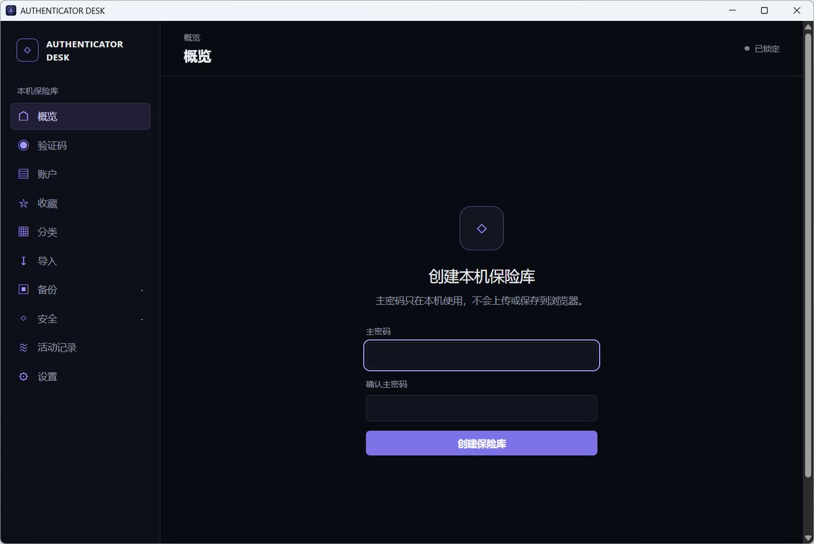</td>
    <td>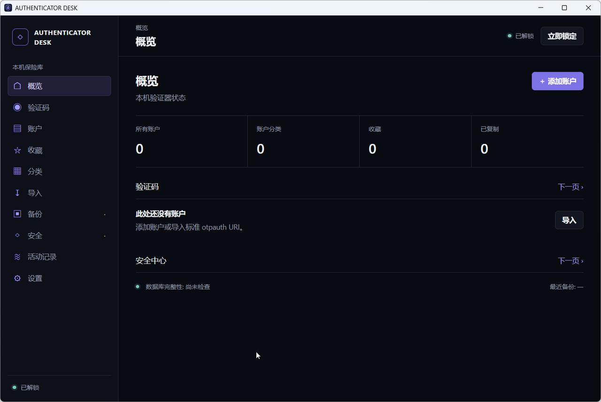</td>
  </tr>
  <tr>
    <td align="center">Create or unlock a local vault</td>
    <td align="center">Overview, account counts and vault health</td>
  </tr>
  <tr>
    <td>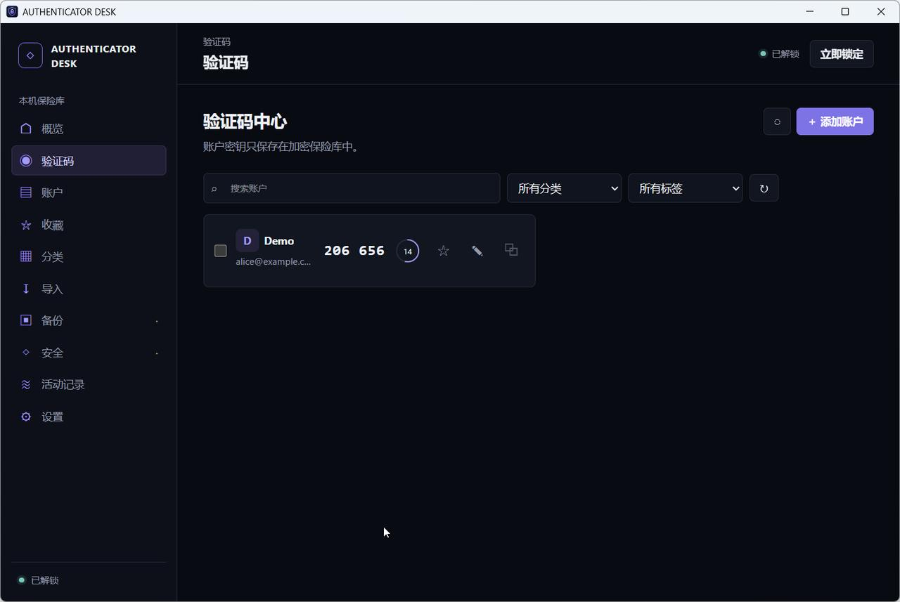</td>
    <td>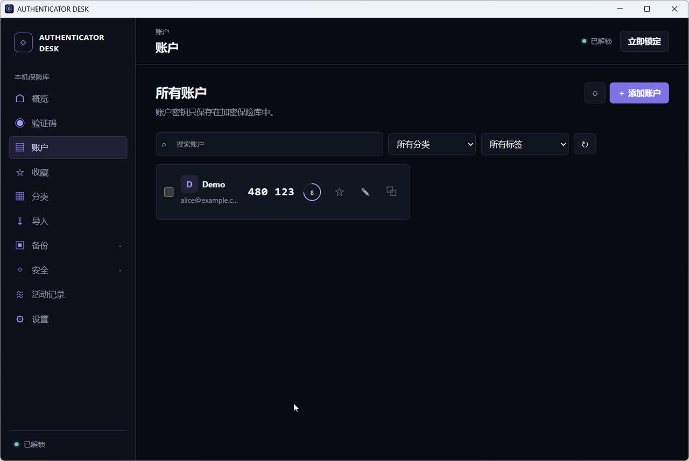</td>
  </tr>
  <tr>
    <td align="center">Live TOTP/HOTP codes and countdowns</td>
    <td align="center">Account editing, favorites and categories</td>
  </tr>
  <tr>
    <td>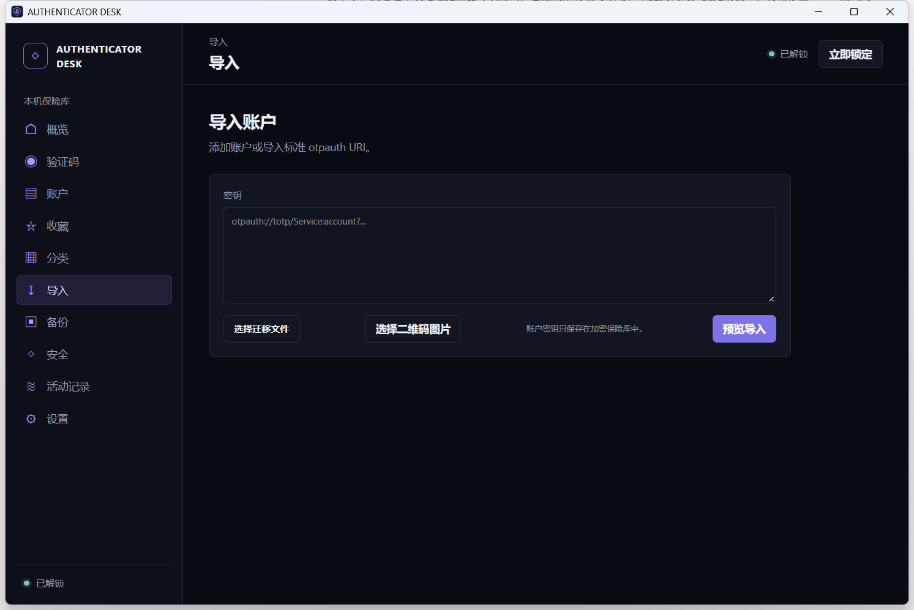</td>
    <td>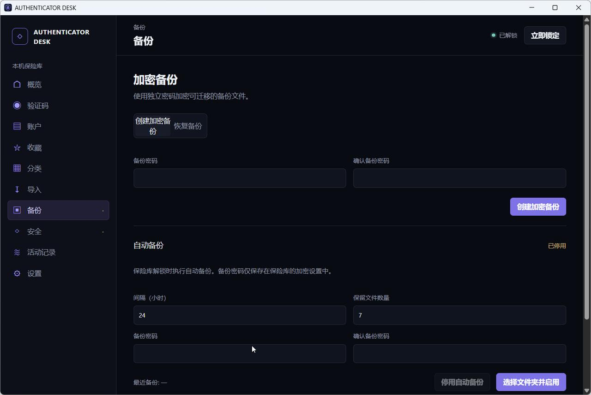</td>
  </tr>
  <tr>
    <td align="center">Preview, select and commit imports</td>
    <td align="center">Encrypted backup and restore</td>
  </tr>
  <tr>
    <td>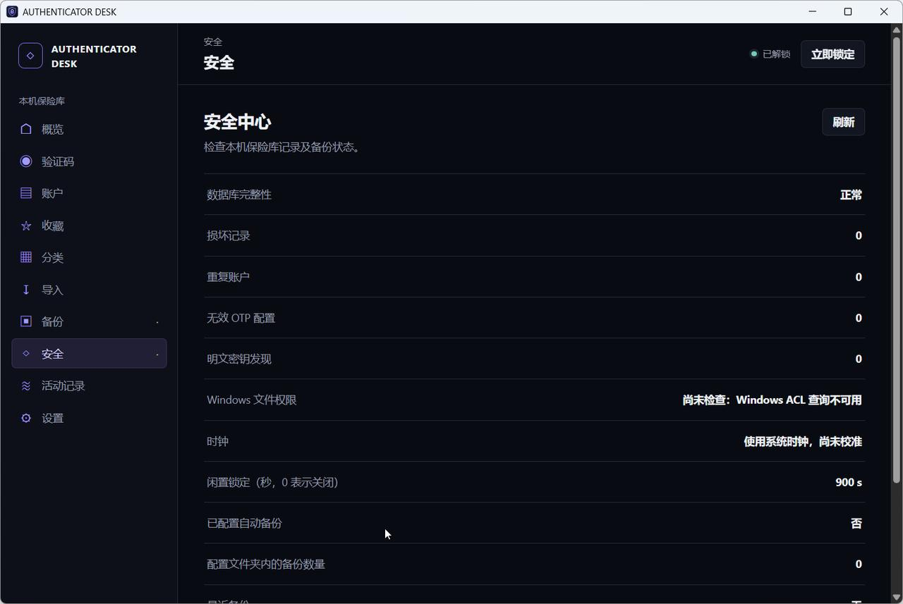</td>
    <td>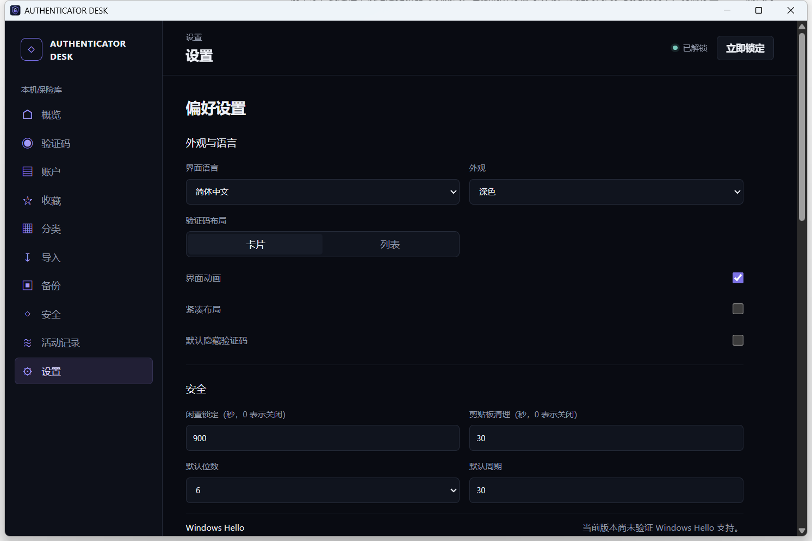</td>
  </tr>
  <tr>
    <td align="center">Integrity and configuration checks</td>
    <td align="center">Locking, idle timeout and desktop preferences</td>
  </tr>
  <tr>
    <td>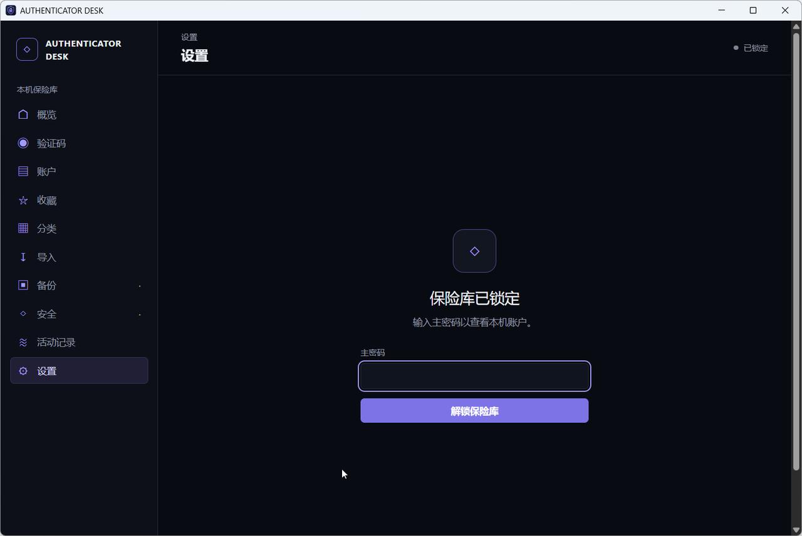</td>
    <td>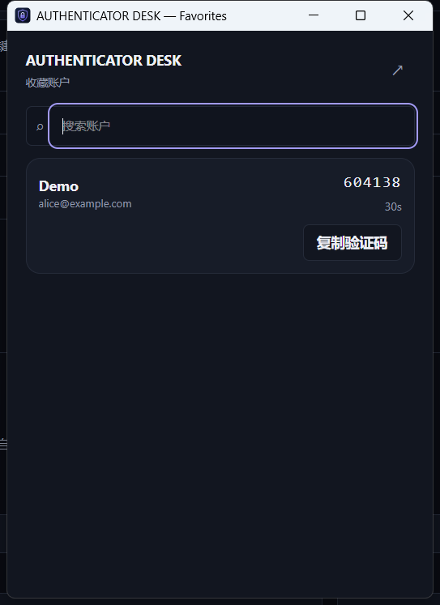</td>
  </tr>
  <tr>
    <td align="center">Vault locked: unlock to view accounts</td>
    <td align="center">Quick panel for favorite accounts</td>
  </tr>
</table>

## Features

### Vault and account lifecycle

- Create, unlock, lock and recover an encrypted local vault. Recovery depends on a verifiable backup or a readable vault state; this is not a general-purpose corruption repair tool.
- Store account issuer, account name, algorithm, digits, period, HOTP counter, notes, categories, ordering and favorites.
- Generate TOTP and HOTP codes locally. Advancing the HOTP counter is an explicit, auditable action; it does not automatically synchronize with a server.
- Search and filter by category, manage accounts in bulk, and use card/list views and light/dark themes.
- Hide codes and disable copying while the vault is locked or the hide-codes preference is active.
- Lock on demand, when the idle timeout expires or on process exit. Locking clears pending imports, restore previews and cached codes, and releases clipboard ownership after applying the ownership check.

### Import and migration

Pasting text, opening a local file and importing a QR image all use the same preview-first flow. **Camera capture is not supported.** The Rust reader classifies every row before writing to the vault. Only valid rows still marked `new` can be committed in a transaction.

| Format | Status |
|---|---|
| `otpauth://` lists, including plaintext Ente exports | Supported |
| Google Authenticator migration URIs | Supported |
| Aegis plaintext JSON | Supported |
| 2FAS plaintext JSON, schema versions 1–4 | Supported |
| andOTP plaintext JSON | Supported |
| Aegis, 2FAS, andOTP and Ente encrypted exports | Detected and rejected as `unsupported_encrypted_format`; no decryption is attempted |
| FreeOTP 2.x serialized/XML backups | Detected and rejected; no Android Keystore or password bypass is attempted |
| Steam token formats | Reported as unsupported; never silently converted to numeric TOTP |

Imports are limited to 2 MiB and 1,000 rows. Duplicate detection uses the issuer, account and a fingerprint of the decoded secret. Imported secrets remain in a short-lived Rust in-memory preview and are not returned to the interface in preview results. The preview is cleared on lock or revision change. Pasted text itself does pass through the WebView. See the [migration format matrix](docs/migration-format-matrix.md) for field-level rules and where test fixtures came from.

### Backups and recovery

- Create password-encrypted `.authdesk` backups with an independent Argon2id salt and AES-256-GCM encryption.
- Validate and preview a restore, then explicitly choose a merge or replacement. The app checks conflict counts and structural limits before committing; replacement requires an additional confirmation.
- On Windows, automatic backups use a vault-specific encrypted ownership manifest and a retention policy. Cleanup only removes files proven to belong to that vault, not arbitrary manual backups or unrelated files.
- **Losing the backup password means losing access to that backup.** There is no recovery key, hosted recovery service or password reset.
- Keep a known-recoverable backup and fully exit old clients before upgrading. A newer version being able to read old backups does not guarantee that an older version can read newer automatic-backup metadata.
- Publication and cleanup of backup files on FAT32, exFAT and network filesystems have not completed acceptance testing. Do not assume the same guarantees on every filesystem.

### Windows desktop integration

The `desktop` feature adds native integrations that are not available in the browser shell:

- system tray behavior and a quick panel for favorites;
- global shortcuts, including quick access to favorite codes;
- autostart and test notifications;
- native dialogs for selecting files and QR images;
- clipboard cleanup that checks ownership so it does not clear a value the user copied later.

Tray clicks, shortcut conflicts, login startup, OS notifications and the system clipboard still need separate acceptance tests in the actual environment. Contract tests are not a substitute for those checks.

The browser shell is useful for frontend development, but it explicitly reports that the desktop security backend is unavailable. Use `pnpm tauri dev` to run the native Tauri/WebView2 app, or use a desktop installer.

## Getting started

1. Download a Windows x64 installer from the [release page](https://github.com/yuchen0x1/authenticator-desk/releases/latest). Keep the same installer family when upgrading.
2. Create a vault on first launch and choose a master password. There is no public demo account or universal default password.
3. Add an account manually, or use Import to paste a URI, select a file or select a QR image. Review the preview before committing.
4. View and copy codes on the Codes or Accounts page. Advance HOTP counters only when needed.
5. Create an encrypted backup on the Backup page and keep its password safe.
6. In Settings, choose the interface language, light/dark theme, idle lock timeout and clipboard cleanup time.

TOTP depends on the device's system clock. Incorrect time can make codes unusable. Do not upload real secrets, QR codes, vaults or backups to issues.

## Security model and limits

The security boundary is local and explicit:

- Only the Rust core reads SQLite, derives keys, encrypts or decrypts records, parses imports and writes backups.
- Argon2id derives vault keys; AES-256-GCM encrypts records. Record IDs are bound as additional authenticated data. OTP secrets and decrypted buffers use zeroizing types.
- The frontend does not persist the master password, derived key, OTP seed or plaintext backup. However, manually entered passwords and secrets, as well as pasted import text, pass briefly through the WebView. Do not describe secrets as never passing through the frontend. Errors return stable codes and safe messages, not SQL, paths or secret material.
- The app clears the clipboard only if it still owns the exact value it wrote. Windows clipboard history, cloud sync and a compromised OS are outside that guarantee.
- Update checks are initiated by the user, use GitHub over HTTPS and do not send vault contents. Before installation, update payloads are checked against hashes and the configured detached-signature policy.

Important limits:

- This is open-source local software. Obfuscation cannot protect an unlocked vault from a compromised OS or debugger.
- Encrypted third-party exports are deliberately unsupported; the app does not guess how to decrypt them.
- The published v0.3.1 installers are **Authenticode `NotSigned`**. Updater/Minisign signatures verify release payload integrity; they are not a Windows publisher certificate.
- **One dependency security advisory remains open:** `RUSTSEC-2024-0429` affects `glib 0.18.5`, a transitive Linux GTK dependency. It is not in the Windows x64 target dependency graph, but the lockfile advisory remains unresolved and remediation is blocked on upstream. See the [open dependency security advisory](docs/known-limitations.md#open-dependency-security-advisory).
- Windows 11 x64 is the native desktop acceptance target. Linux and macOS CI validate the portable core, not a complete native desktop experience.
- Windows Hello, camera capture, encrypted third-party backup decryption, cloud sync and password recovery are not currently implemented capabilities. Publisher signing, exclusion from clipboard history and cloud sync, a genuine signed automatic upgrade and rollback from an older version, an old-version MSI upgrade, Windows ACL inspection and full native interaction each require separate acceptance evidence. See the [known limitations](docs/known-limitations.md) and [test report](docs/test-report.md).

## Architecture

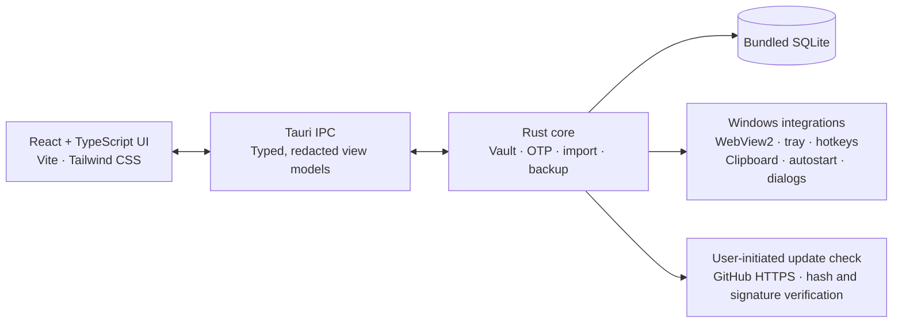

A normal deployment has no application server. The `desktop` feature links the native Tauri integrations, and `signed-updater` additionally enables signed-update logic. The default Rust feature set keeps the portable core testable without linking the desktop runtime.

## Technology stack

| Layer | Technology | Version / role |
|---|---|---|
| Desktop shell | Tauri | Rust crate 2.12.6; JS API and CLI 2.12.5 |
| Frontend | React, React DOM | 19.3.1 |
| Frontend toolchain | Vite, TypeScript, Tailwind CSS | 8.3.8 · 7.0.2 · 4.3.5 |
| Native core | Rust | 1.99.1 toolchain, edition 2024 |
| Local persistence | SQLite via `rusqlite` | Bundled SQLite; schema 1 |
| Cryptography | Argon2id, AES-GCM, HMAC-SHA1/256/512, `zeroize` | Vault, backup and OTP operations |
| Testing | Vitest, Testing Library, Rust tests, Node test runner | 5.1.0 · 16.3.3 · `cargo test` · `node --test` |
| Package manager | pnpm | 11.20.0 |

For authoritative dependency versions, see `package.json`, `pnpm-lock.yaml`, `src-tauri/Cargo.toml` and `rust-toolchain.toml`. This overview does not replace the lockfiles.

## Download and upgrade

Download the published [v0.3.1](https://github.com/yuchen0x1/authenticator-desk/releases/tag/v0.3.1) from GitHub Releases:

- Choose the NSIS (`.exe`) or MSI installer family.
- Keep the same installer family when upgrading.
- Verify the checksums in `SHA256SUMS.txt` and, if your workflow supports Minisign, the detached `.sig` files.
- Back up the vault and fully exit all running clients before installation.

The published release has seven assets: two installers, two detached signatures, `release-assets.json`, `SHA256SUMS.txt` and `update.json`. The [post-publication test report](docs/test-report.md) records independent download verification and an actual manual NSIS upgrade from v0.1.0 to v0.3.1 in an isolated environment. That evidence does **not** establish a Windows publisher certificate, an MSI upgrade from an older version or full acceptance of automatic installation through the updater.

## Development setup

### Prerequisites

- Windows 11 x64 for native desktop development and acceptance testing;
- Node.js 26.13.1 and pnpm 11.20.0;
- Rust 1.99.1 with the MSVC toolchain;
- Visual Studio 2022 C++ Build Tools;
- Microsoft Edge WebView2 Runtime.

The repository pins the Rust toolchain in `rust-toolchain.toml` and the package manager in `package.json`.

### Install and run

First, follow the [official pnpm installation guide](https://pnpm.io/installation) to install pnpm 11.20.0, then confirm with `pnpm --version`. Do not assume Corepack comes with Node.js 26. If you choose the Corepack approach, install Corepack separately as described in the guide; it is not required if you use another installation method.

```powershell
pnpm install --frozen-lockfile

# Browser shell: frontend only; the native vault/security backend is unavailable.
pnpm dev

# Native app: Tauri IPC and Windows integrations.
pnpm tauri dev
```

For a clean, isolated test vault, set `AUTHDESK_DATA_DIR` to a temporary directory before starting the native app. Do not point it at a production vault or delete a live `.lock` sidecar to bypass another process.

### Verification commands

```powershell
# Frontend and release-contract checks
pnpm exec vitest run
node --test scripts/*.test.mjs
pnpm exec tsc --noEmit
pnpm build

# Portable Rust core and native contracts
cargo test --locked --manifest-path src-tauri/Cargo.toml
cargo test --locked --manifest-path src-tauri/Cargo.toml --features desktop --test desktop
cargo check --locked --manifest-path src-tauri/Cargo.toml --features signed-updater --bin authenticator-desk
```

The verifier for a staged signed release requires real release-key artifacts; a mock is not a substitute. Read the [dated test report](docs/test-report.md) before interpreting a local pass. It distinguishes published-release evidence, local maintenance checks, unsigned artifacts and areas that have not been qualified.

## Documentation map

The in-depth documents below are mainly in English. Four interface and README languages do not mean that all documentation has been translated.

| Document | Purpose |
|---|---|
| [Security model](docs/security-model.md) | Vault trust boundaries, cryptography, locking, imports, backups and network behavior |
| [Migration format matrix](docs/migration-format-matrix.md) | Supported and rejected formats, field rules, limits and test fixture provenance |
| [Updating and recovery](docs/updating.md) | Release discovery, signature and hash checks, rollback and recovery |
| [Known limitations](docs/known-limitations.md) | What this release does not claim to support |
| [Test report](docs/test-report.md) | Dated evidence from local tests, hosted CI, packaging, releases and upgrades |
| [Maintenance record](docs/maintenance.md) | Platform decisions and release acceptance criteria |
| [Release history](docs/releases/release-notes.md) | Published and candidate release notes |
| [v0.3.1 release notes](docs/releases/v0.3.1.md) | Published release scope, compatibility and limits |
| [Research and backlog](docs/research/ecosystem.md) | Authenticator ecosystem observations and follow-up work |
| [Contributing](CONTRIBUTING.md) | Branch, pull request and release contribution workflow |
| [Security reporting](SECURITY.md) | Rules for private vulnerability reporting |

## Project status and roadmap

### Supported scope and available evidence

- Windows 11 x64 is the native desktop target, with NSIS and MSI packaging.
- Local encrypted vault, TOTP/HOTP generation, import preview and commit, and encrypted backup and restore.
- Portable Rust core tests on Ubuntu and macOS in CI.
- Published v0.3.1 with independently verified release assets and evidence of an isolated manual NSIS upgrade.

### Still being qualified

- Local maintenance changes after release are separate from the immutable v0.3.1 assets.
- Signed automatic installation and rollback need their own evidence on a clean runner, using real release keys and an older version as the starting point.
- Windows publisher identity, ACL inspection, clipboard history and cloud sync behavior, and full native resilience still need independent acceptance evidence.

### Not currently claimed as supported

- Native Linux or macOS desktop distributions;
- Windows Hello, camera capture or recovery of encrypted third-party imports;
- browser, PWA or server-hosted vaults;
- Authenticode publisher signing;
- password recovery or a recovery-key service.

The project favors a small support matrix backed by evidence. See the [maintenance decisions](docs/maintenance.md) before requesting support for a platform feature.

## Contributing and security reports

Use a short-lived branch from `main` and open a pull request. Keep vault migrations compatible with existing data, use synthetic credentials in tests, and document user-visible changes in the relevant release notes. CI covers the portable Rust core, the frontend, Windows packaging and installer lifecycle checks. See [`.github/workflows/ci.yml`](.github/workflows/ci.yml) for the exact workflow.

Never include vault databases, backup files, passwords, QR codes, OTP seeds, signing keys or production tokens in an issue or pull request. To report a vulnerability, use [GitHub private vulnerability reporting](https://github.com/yuchen0x1/authenticator-desk/security/advisories/new) and follow [SECURITY.md](SECURITY.md).

## License

AUTHENTICATOR DESK is released under the [MIT License](LICENSE). This license covers the repository; bundled and transitive dependencies retain their own licenses and notices.

<p align="center">
  <strong>Keep the vault local. Know how to recover it.</strong>
  <br />
  Built for people who want to keep their second factor under their own control.
</p>
