[简体中文](README.md) | [繁體中文](README.zh-TW.md) | [English](README.en.md) | **[日本語](README.ja.md)（現在）**

<p align="center">
  
</p>

<h1 align="center">AUTHENTICATOR DESK</h1>

<p align="center">
  オフラインでの利用を重視した、Windows デスクトップ向けの TOTP・HOTP 認証アプリ。
  <br />
  保管庫は手元に。信頼できる範囲は明確に。
</p>

<p align="center">
  <a href="https://github.com/yuchen0x1/authenticator-desk/releases/latest"></a>
  <a href="https://github.com/yuchen0x1/authenticator-desk/actions/workflows/ci.yml"></a>
  <a href="LICENSE"></a>
  <a href="https://github.com/yuchen0x1/authenticator-desk/stargazers"></a>
  <a href="https://github.com/yuchen0x1/authenticator-desk/network/members"></a>
</p>

<p align="center">
  <a href="https://github.com/yuchen0x1/authenticator-desk/releases/latest">Windows 版をダウンロード</a>
  ·
  <a href="docs/security-model.md">セキュリティモデル</a>
  ·
  <a href="docs/test-report.md">検証記録</a>
  ·
  <a href="https://github.com/yuchen0x1/authenticator-desk/issues">不具合の報告</a>
</p>

> **公開済みリリース：** [v0.3.1](https://github.com/yuchen0x1/authenticator-desk/releases/tag/v0.3.1)。対象コミットは `7ae5151e3041487f9e46ac4cec943fbd20553daf` です。本文のインストーラーと検証記録はこの公開済みリリースに関するものであり、今回の文書更新で新しくビルドしたものではありません。
> リリースページでは NSIS（`.exe`）と MSI のインストーラー、分離署名、チェックサム、`update.json` を提供しています。その後のソースや文書の変更が、公開済みインストーラーに反映されているとは限りません。

## AUTHENTICATOR DESK を選ぶ理由

AUTHENTICATOR DESK は、二要素認証のアカウントを自分の端末で管理したい人のためのアプリです。ローカルの暗号化保管庫を使用し、クラウドアカウントへの登録は不要です。LAN 上での待ち受け、HTTP API、データベースサーバー、サブスクリプション用バックエンドはありません。保管庫と暗号処理は Rust コアが管理し、React の画面には Tauri IPC を通じて、機密情報を除いた型付きの表示用モデルを渡します。

- **ローカル優先：** 暗号化された SQLite 保管庫を、既定では Tauri のアプリデータディレクトリに保存します。
- **標準に準拠：** TOTP・HOTP に対応し、RFC 6238・RFC 4226 のテストベクトルで検証します。HMAC-SHA1、SHA-256、SHA-512 を利用できます。
- **内容を確認してから実行：** インポートはプレビュー後に確定し、復元前には競合を確認します。重要なデータを黙って上書きしません。
- **Windows を主な対象に：** Windows 11 x64 と WebView2 がネイティブデスクトップ版の受け入れテスト対象です。Linux・macOS の CI が検証するのは移植可能な Rust コアであり、デスクトップ機能全体への対応を意味しません。
- **4 つの表示言語：** 简体中文、繁體中文、English、日本語を選択できます。README の言語切り替えとアプリ内の言語設定は別です。

## 画面紹介

以下は、リポジトリに以前から含まれている実際の画面のスクリーンショットです。空の保管庫または架空のデモデータを使用しており、今回撮り直したものではありません。署名や現行インストーラーの状態、すべてのデスクトップ操作の検証完了を示すものでもありません。

アプリの表示言語は **設定 → 外観と言語 → 言語**（英語表示では **Settings → Appearance and language → Language**）で切り替えられます。简体中文、繁體中文、English、日本語から選んで保存してください。未翻訳の表示が残る場合があります。

<table>
  <tr>
    <td>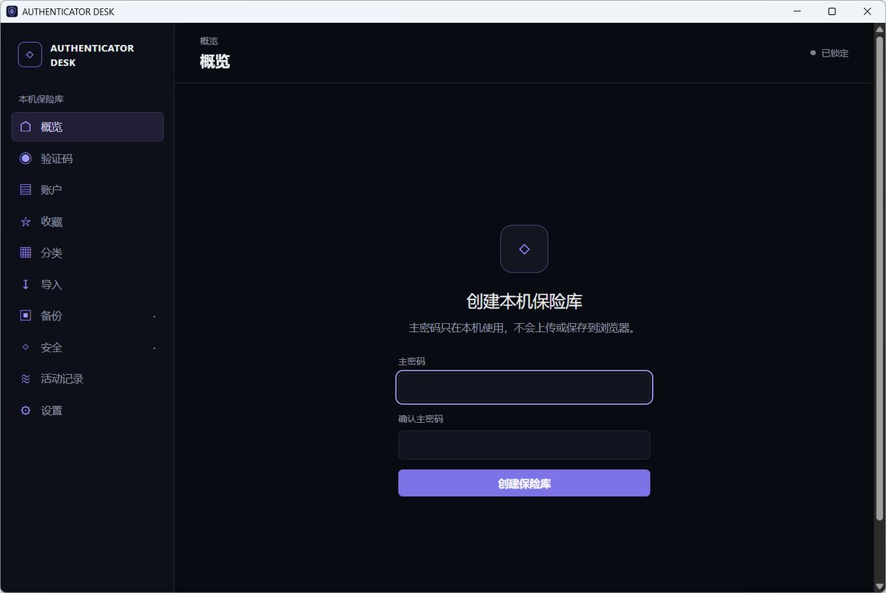</td>
    <td>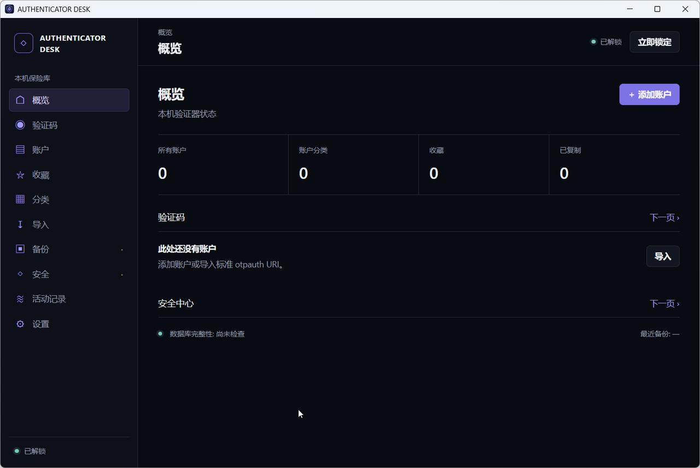</td>
  </tr>
  <tr>
    <td align="center">ローカル保管庫の作成とロック解除</td>
    <td align="center">アカウント数と保管庫の状態を確認</td>
  </tr>
  <tr>
    <td>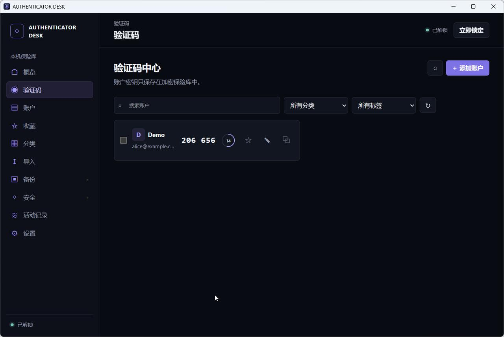</td>
    <td>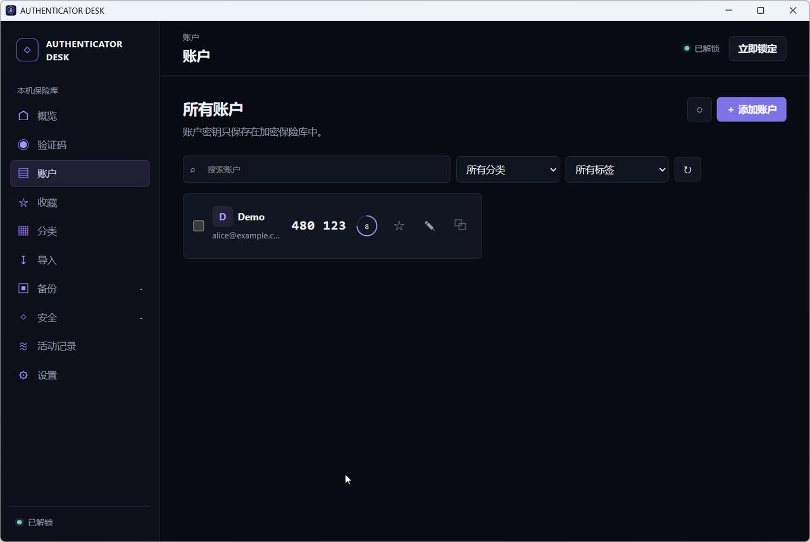</td>
  </tr>
  <tr>
    <td align="center">認証コードとカウントダウン</td>
    <td align="center">アカウントの編集、お気に入り、カテゴリ</td>
  </tr>
  <tr>
    <td>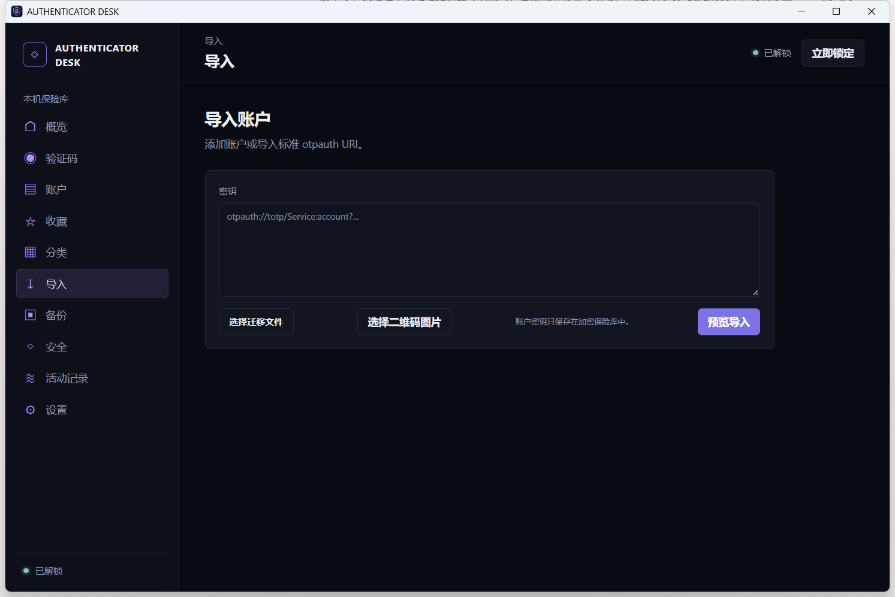</td>
    <td>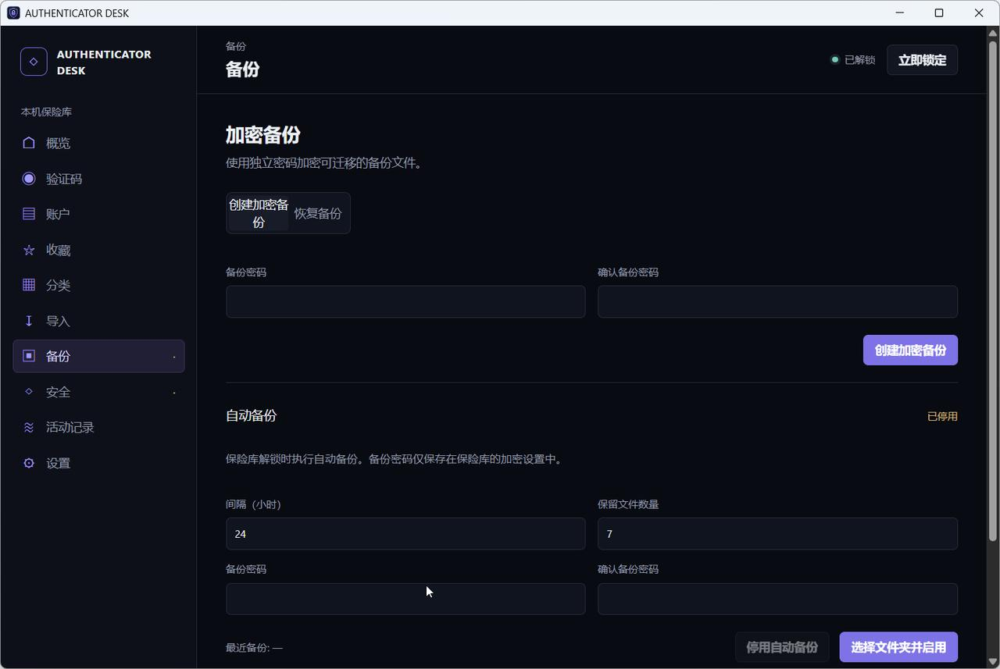</td>
  </tr>
  <tr>
    <td align="center">内容を確認し、選択してインポートを確定</td>
    <td align="center">暗号化バックアップと復元</td>
  </tr>
  <tr>
    <td>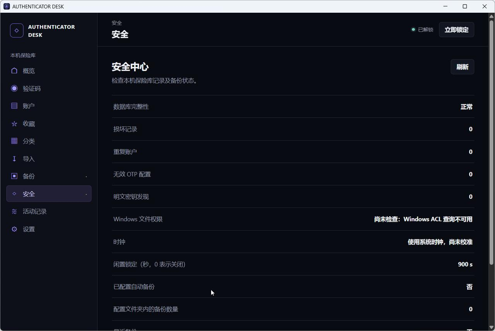</td>
    <td>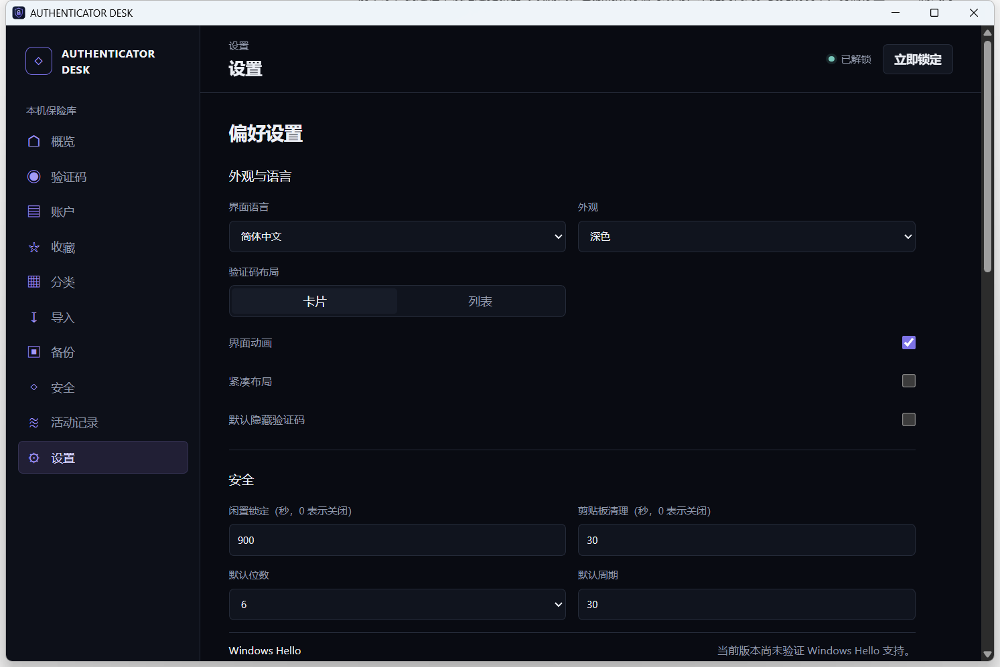</td>
  </tr>
  <tr>
    <td align="center">整合性と設定の確認</td>
    <td align="center">言語、外観、デスクトップ設定</td>
  </tr>
  <tr>
    <td>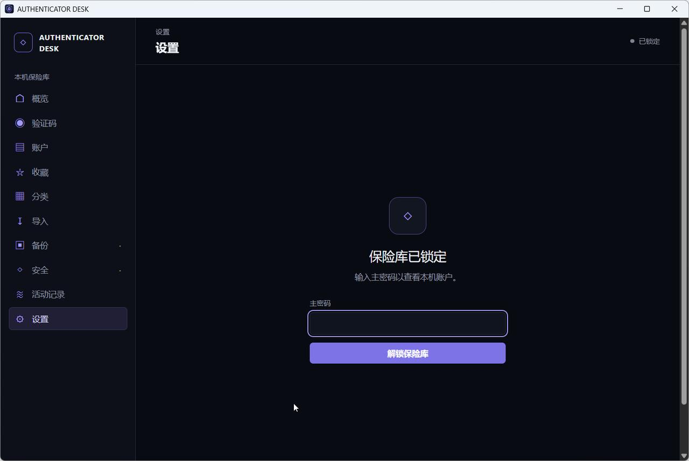</td>
    <td>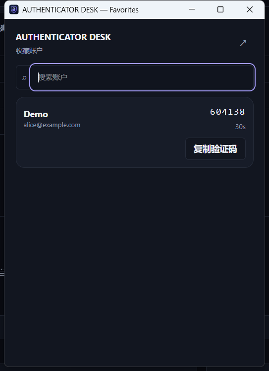</td>
  </tr>
  <tr>
    <td align="center">ロック中は機密情報を非表示に</td>
    <td align="center">独立したウィンドウでお気に入りにアクセス</td>
  </tr>
</table>

## 機能

### 保管庫とアカウントの管理

- ローカルの暗号化保管庫を作成、ロック解除、ロック、復元できます。復元には検証可能なバックアップや読み取り可能な保管庫の状態が必要であり、あらゆる破損を修復できるわけではありません。
- 発行者、アカウント名、アルゴリズム、桁数、周期、HOTP カウンター、メモ、カテゴリ、並び順、お気に入りを管理できます。
- TOTP・HOTP コードをローカルで生成します。HOTP カウンターは明示的な操作で進め、その操作は監査可能です。サーバーと自動同期はしません。
- 検索、カテゴリによる絞り込み、一括管理、カード／リスト表示、ライト／ダークテーマ、コードの非表示に対応します。保管庫がロック中、またはコードを非表示にする設定が有効な間は、コードの表示とコピーを無効にします。
- 手動ロック、アイドル時間の超過、プロセス終了時にセッション状態を消去します。ロック時には、確定前のインポートや復元の平文プレビュー、コードのキャッシュを破棄し、所有権を確認したうえでクリップボードの管理状態も解除します。

### インポートと移行

テキストの貼り付け、ローカルファイルの選択、QR コード画像の選択に対応します。**カメラでの読み取りには対応していません。** いずれも「プレビュー → 選択 → トランザクションで確定」の流れです。Rust 側で各行を分類し、引き続き `new` と判定されている有効な行のみを書き込みます。

| 形式 | 対応状況 |
|---|---|
| `otpauth://` の一覧（Ente の平文エクスポートを含む） | 対応 |
| Google Authenticator の移行 URI | 対応 |
| Aegis の平文 JSON | 対応 |
| 2FAS の平文 JSON（スキーマバージョン 1–4） | 対応 |
| andOTP の平文 JSON | 対応 |
| Aegis、2FAS、andOTP、Ente の暗号化エクスポート | 検出後に `unsupported_encrypted_format` として拒否し、復号は試みません |
| FreeOTP 2.x のシリアライズ形式／XML バックアップ | 検出して拒否します。Android Keystore やパスワードの回避は試みません |
| Steam 独自のトークン形式 | 非対応。通常の数字のみの TOTP に黙って変換することはありません |

入力上限は 2 MiB、1,000 行です。発行者、アカウント、デコード済みシークレットのフィンガープリントで重複を検出します。シークレットは Rust のメモリ上のプレビューに短時間保持し、プレビュー結果として画面には返しません。ロック時やリビジョン変更時には消去します。ただし、貼り付けたテキスト自体は WebView を通ります。項目ごとの仕様やテストデータの出典は[移行形式一覧](docs/migration-format-matrix.md)を参照してください。

### 暗号化バックアップと復元

- `.authdesk` バックアップを、独立した Argon2id ソルトと AES-256-GCM でパスワード暗号化します。
- 復元前に検証とプレビューを行い、マージまたは置き換えを明示的に選びます。確定前に競合数やデータ構造の制限を確認し、置き換えには追加の確認が必要です。
- Windows の自動バックアップは、保管庫ごとの暗号化された所有権マニフェストに基づいて保存世代を管理します。その保管庫のものだと確認できるファイルだけを削除し、手動バックアップや無関係なファイルを無差別に削除しません。
- **バックアップのパスワードを失うと復元できません。** 復旧キー、保管代行サービス、パスワードリセット機能はありません。
- アップグレード前には復元可能なことが分かっているバックアップを保存し、旧版を完全に終了してください。新版が旧バックアップを読めることから、旧版も新版の自動バックアップ用メタデータを読めると判断してはいけません。
- FAT32、exFAT、ネットワークファイルシステムでのバックアップファイルの確定や削除は検証未完了です。どのファイルシステムでも同じ動作を保証するわけではありません。

### Windows デスクトップ連携

`desktop` feature は、システムトレイ、お気に入り用の独立したクイックパネル、グローバルショートカット、Windows 起動時の自動起動、テスト通知、ファイルや QR 画像を選択するネイティブダイアログ、所有権を確認するクリップボード消去を提供します。後からユーザーがコピーした値を消去しない設計です。

トレイの操作、ショートカットの競合、ログイン時の起動、OS の通知やクリップボードは、実際の環境で個別に検証する必要があります。インターフェースの契約テストが通っても、OS 上の操作をすべて検証したことにはなりません。

ブラウザー版の開発用画面では、ネイティブのセキュリティバックエンドが利用できないことを明示します。保管庫、Tauri IPC、Windows 連携を使うには `pnpm tauri dev` でネイティブアプリを起動するか、デスクトップ版をインストールしてください。

## 使い始めるには

1. [リリースページ](https://github.com/yuchen0x1/authenticator-desk/releases/latest)から Windows x64 のインストーラーをダウンロードします。更新時は同じ種類のインストーラーを使ってください。
2. 初回起動時に保管庫を作成し、マスターパスワードを設定します。公開デモ用アカウントや共通の初期パスワードはありません。
3. アカウントを手動で追加するか、「インポート」で URI の貼り付け、ファイルまたは QR 画像の選択を行います。内容を確認してから確定してください。
4. 認証コードまたはアカウントの画面でコードを表示、コピーします。HOTP カウンターは必要なときだけ進めてください。
5. 「バックアップ」で暗号化バックアップを作成し、そのパスワードを安全に保管します。
6. 「設定」で表示言語、テーマ、アイドル時のロック時間、クリップボード消去までの時間を選択します。

TOTP は端末のシステム時計に依存します。時刻がずれているとコードが使えない場合があります。実際のシークレット、QR コード、保管庫、バックアップを Issue にアップロードしないでください。

## セキュリティモデルと制限

- **主要データは Rust が管理：** SQLite の読み書き、鍵導出、レコードの暗号化・復号、インポートの解析、バックアップの生成を担います。
- **Argon2id と AES-256-GCM：** レコード ID を追加認証データとして結び付けます。OTP シークレットや復号済みバッファーには、内容をゼロ化して消去する型を使用します。
- **フロントエンドにシークレットを永続保存しない：** マスターパスワード、導出鍵、OTP シード、平文バックアップは永続化しません。ただし、手入力のパスワードやシークレット、貼り付けたインポート内容は一時的に WebView を通るため、「シークレットがフロントエンドを一切通らない」とは言えません。エラーは安定したコードと安全なメッセージで返し、SQL、パス、機密情報を含めません。
- **所有するクリップボードの値だけを消去：** アプリが書き込んだ値を引き続き所有し、値も完全に一致する場合にのみ消去します。後からユーザーがコピーした内容は消去しません。Windows のクリップボード履歴、クラウド同期されたコピー、侵害された OS は保証の対象外です。
- **更新確認はユーザーの操作で実行：** HTTPS で GitHub にアクセスし、保管庫の内容は送信しません。インストール前にハッシュ値と、設定された分離署名の検証方針に従って更新ファイルを検証します。

明示しておくべき制限：

- 公開済み v0.3.1 の EXE・MSI は、Windows Authenticode の状態が **`NotSigned`** です。Minisign／updater の署名はリリースファイルの完全性を検証するものであり、Windows の発行元証明書ではありません。
- **未解決の依存関係の警告が 1 件あります：** Linux GTK 経由の間接依存 `glib 0.18.5` に `RUSTSEC-2024-0429` が該当します。Windows x64 の依存グラフには含まれませんが、ロックファイル内の警告は未修正で、解消は上流の対応待ちです。[未解決の依存関係のセキュリティ勧告](docs/known-limitations.md#open-dependency-security-advisory)を参照してください。
- Windows Hello、カメラ読み取り、第三者の暗号化バックアップの復号、クラウド同期、パスワード復旧は現在の実装済み機能ではありません。
- OS やデバッガーがロック解除済みのプロセスを制御している場合、オープンソースであること、暗号化、コードの難読化によって平文の不可視性を保証することはできません。
- Linux・macOS で検証するのは移植可能なコアです。完全なネイティブデスクトップ対応を示すものではありません。
- 実際の旧版からの署名付き自動更新とロールバック、旧版 MSI の更新、Windows ACL、クリップボード履歴・クラウド同期からの除外、ネイティブ操作全体には、それぞれ別の検証記録が必要です。

[セキュリティモデル](docs/security-model.md)、[既知の制限](docs/known-limitations.md)、[日付付きのテスト報告](docs/test-report.md)も参照してください。

## アーキテクチャ

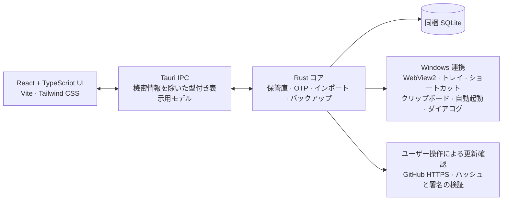

通常の構成にアプリケーションサーバーはありません。Rust の既定の feature はデスクトップランタイムをリンクせず、移植可能なコアをテストできる構成です。`desktop` はネイティブ連携をリンクし、`signed-updater` はさらに署名付き更新のロジックを有効にします。

## 技術スタック

| 層 | 技術 | バージョン／役割 |
|---|---|---|
| デスクトップ基盤 | Tauri | Rust crate 2.12.6、JS API・CLI 2.12.5 |
| フロントエンド | React、React DOM | 19.3.1 |
| フロントエンドのツール | Vite、TypeScript、Tailwind CSS | 8.3.8 · 7.0.2 · 4.3.5 |
| ネイティブコア | Rust | ツールチェーン 1.99.1、edition 2024 |
| ローカルストレージ | `rusqlite` による SQLite | SQLite を同梱、スキーマ 1 |
| 暗号処理 | Argon2id、AES-GCM、HMAC-SHA1/256/512、`zeroize` | 保管庫、バックアップ、OTP |
| テスト | Vitest、Testing Library、Rust テスト、Node テストランナー | 5.1.0 · 16.3.3 · `cargo test` · `node --test` |
| パッケージ管理 | pnpm | 11.20.0 |

正確な依存バージョンは `package.json`、`pnpm-lock.yaml`、`src-tauri/Cargo.toml`、`rust-toolchain.toml` を参照してください。この表はロックファイルの代わりにはなりません。

## ダウンロード、検証、アップグレード

公開済みの [v0.3.1](https://github.com/yuchen0x1/authenticator-desk/releases/tag/v0.3.1) には、インストーラー 2 個、分離署名 2 個、`release-assets.json`、`SHA256SUMS.txt`、`update.json` の計 7 ファイルがあります。

- NSIS（`.exe`）か MSI を選び、アップグレードでも同じ種類を使います。
- `SHA256SUMS.txt` のチェックサムを確認し、Minisign を利用できる場合は分離署名の `.sig` も検証します。
- 保管庫をバックアップし、トレイ内のものも含め、実行中の旧版をすべて終了してからインストールします。
- [公開後のテスト報告](docs/test-report.md)には、独立したダウンロード検証と、隔離環境で実際に行った v0.1.0 → v0.3.1 の**手動 NSIS アップグレード**および既存保管庫の再オープンの記録があります。これは、Windows 発行元証明書、旧版 MSI の更新、自動 updater によるインストールが検証済みという意味ではありません。
- 失敗時には元のデータとバックアップを保持し、[更新と復旧のガイド](docs/updating.md)を参照してください。使用中のインスタンスの `.lock` ファイルを削除してはいけません。

## 開発環境

### 前提条件

- ネイティブデスクトップ開発と受け入れテストの対象である Windows 11 x64；
- Node.js 26.13.1、pnpm 11.20.0；
- MSVC ツールチェーンを使用する Rust 1.99.1；
- Visual Studio 2022 C++ Build Tools；
- Microsoft Edge WebView2 Runtime。

Rust は `rust-toolchain.toml`、パッケージマネージャーは `package.json` でバージョンを固定しています。

### インストールと起動

まず [pnpm 公式のインストール手順](https://pnpm.io/installation)に従って pnpm 11.20.0 を導入し、`pnpm --version` で確認してください。Node.js 26 に Corepack が同梱されているとは限りません。Corepack を使う場合はガイドに従って別途インストール、設定してください。他の方法で pnpm を導入する場合、Corepack は不要です。

```powershell
pnpm install --frozen-lockfile

# ブラウザーの開発用画面。ネイティブの保管庫・セキュリティバックエンドは利用できません。
pnpm dev

# ネイティブアプリ。Tauri IPC と Windows 連携を使用します。
pnpm tauri dev
```

隔離した空の保管庫でテストするには、ネイティブアプリを起動する前に `AUTHDESK_DATA_DIR` を一時ディレクトリに設定してください。日常使用している保管庫を指定したり、他のプロセスのロックを回避するために使用中の `.lock` サイドカーファイルを削除したりしないでください。

### 検証コマンド

```powershell
# フロントエンドとリリース仕様のチェック
pnpm exec vitest run
node --test scripts/*.test.mjs
pnpm exec tsc --noEmit
pnpm build

# 移植可能な Rust コアとネイティブ機能の契約テスト
cargo test --locked --manifest-path src-tauri/Cargo.toml
cargo test --locked --manifest-path src-tauri/Cargo.toml --features desktop --test desktop
cargo check --locked --manifest-path src-tauri/Cargo.toml --features signed-updater --bin authenticator-desk
```

署名済みリリースのステージング検証には、実際のリリース鍵で生成した成果物と対応する公開鍵が必要です。モックで代替するものではありません。[日付付きのテスト報告](docs/test-report.md)は、公開済みリリース、ローカルの保守作業、未署名の成果物、未検証の項目を区別しています。作業ツリーでのテスト成功を、既存インストーラーが更新された証拠として扱わないでください。

## ドキュメント一覧

以下の詳細文書は主に英語です。アプリと README が 4 言語に対応していても、すべての文書が翻訳済みという意味ではありません。

| 文書 | 内容 |
|---|---|
| [セキュリティモデル](docs/security-model.md) | 信頼境界、暗号処理、ロック、インポート、バックアップ、ネットワーク動作 |
| [移行形式一覧](docs/migration-format-matrix.md) | 対応・非対応の形式、項目の仕様、上限、テストデータの出典 |
| [更新と復旧](docs/updating.md) | リリースの取得、署名・ハッシュの検証、ロールバック、復旧 |
| [既知の制限](docs/known-limitations.md) | 未実装または検証未完了の項目 |
| [テスト報告](docs/test-report.md) | ローカル、CI、パッケージ化、公開、アップグレードの記録を日付別に整理 |
| [保守記録](docs/maintenance.md) | プラットフォームの方針とリリースの判定基準 |
| [リリース履歴](docs/releases/release-notes.md) | 公開版と候補版の変更履歴 |
| [v0.3.1 のリリースノート](docs/releases/v0.3.1.md) | 公開済みリリースの範囲、互換性、制限 |
| [調査と今後の作業](docs/research/ecosystem.md) | 認証アプリのエコシステムの調査と課題 |
| [コントリビューション](CONTRIBUTING.md) | ブランチ、プルリクエスト、リリースへの参加手順 |
| [脆弱性の報告](SECURITY.md) | 非公開で報告するためのルール |

## プロジェクトの現状と今後

### 現在の機能と検証記録

- ローカルの暗号化保管庫、TOTP・HOTP の生成、プレビュー後のインポート、暗号化バックアップと復元、4 言語の表示。
- Windows 11 x64 をネイティブデスクトップ版の対象とし、NSIS・MSI でパッケージ化します。これは、実機の全機能の受け入れテストが完了したという意味ではありません。
- Ubuntu・macOS の CI は移植可能な Rust コアを検証します。Windows の CI にはフロントエンド、Rust、パッケージ化、インストーラーのライフサイクルに関する判定基準があります。
- v0.3.1 は公開済みで、リリースファイルの独立した検証と、隔離環境での手動 NSIS アップグレードの記録があります。

### 個別の検証が必要な項目

- 公開後のローカル変更は、変更されない v0.3.1 のリリースファイルと区別して管理します。
- 署名付き自動更新のインストールとロールバックは、実際のリリース鍵と旧版を用い、クリーンな実行環境で別途検証する必要があります。
- Windows 発行元証明書、ACL 検査、OS のクリップボード履歴とクラウド同期、ネイティブ操作全体の耐障害性、NTFS 以外のストレージでの動作には独立した検証記録が必要です。

### 現時点で対応を表明しない項目

- Linux・macOS 向けネイティブデスクトップ版の配布；
- Windows Hello、カメラ読み取り、第三者の暗号化インポートデータの復号；
- ブラウザー、PWA、サーバーでホストする保管庫；
- Authenticode による発行元署名；
- パスワード復旧や復旧キーのサービス。

対応範囲は検証可能な根拠に基づいて決めます。候補版、ローカル修正、テストコードをそのまま公開済み機能と見なすことはしません。プラットフォームの機能を要望する前に[保守方針](docs/maintenance.md)を確認してください。

## コントリビューションと脆弱性の報告

`main` から短期間の作業ブランチを作り、プルリクエストを送ってください。保管庫の移行は既存データとの互換性を保ち、テストには架空の認証情報を使い、利用者に影響する変更をリリースノートに記載します。CI の具体的な検証手順は [`.github/workflows/ci.yml`](.github/workflows/ci.yml) を参照してください。

保管庫のデータベース、バックアップ、パスワード、QR コード、OTP シード、署名鍵、本番用トークンを Issue やプルリクエストに含めないでください。脆弱性は [GitHub の非公開脆弱性報告](https://github.com/yuchen0x1/authenticator-desk/security/advisories/new)から連絡し、[SECURITY.md](SECURITY.md) に従ってください。

## ライセンス

AUTHENTICATOR DESK のソースコードは [MIT ライセンス](LICENSE)で公開しています。同梱する依存ライブラリと間接依存には、それぞれのライセンスと通知事項が適用されます。

<p align="center">
  <strong>保管庫は手元に。復元の手順も確かに。</strong>
  <br />
  二つ目の認証要素も、自分で管理したい人のために。
</p>
