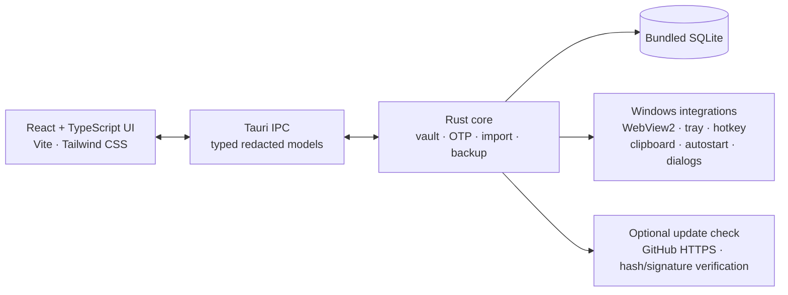

<p align="center">
  
</p>

<h1 align="center">AUTHENTICATOR DESK</h1>

<p align="center">
  An offline-first Windows desktop authenticator for TOTP and HOTP codes.
  <br />
  Keep the vault local, keep the trust boundary visible.
</p>

<p align="center">
  <a href="https://github.com/yuchen0x1/authenticator-desk/releases/latest"></a>
  <a href="https://github.com/yuchen0x1/authenticator-desk/actions/workflows/ci.yml"></a>
  <a href="LICENSE"></a>
  <a href="https://github.com/yuchen0x1/authenticator-desk/stargazers"></a>
  <a href="https://github.com/yuchen0x1/authenticator-desk/network/members"></a>
</p>

<p align="center">
  <a href="https://github.com/yuchen0x1/authenticator-desk/releases/latest">Download the latest Windows release</a>
  ·
  <a href="docs/security-model.md">Security model</a>
  ·
  <a href="docs/test-report.md">Verification evidence</a>
</p>

> **Current release:** [v0.3.1](https://github.com/yuchen0x1/authenticator-desk/releases/tag/v0.3.1), published from tag commit `7ae5151e3041487f9e46ac4cec943fbd20553daf`.
> The release page contains NSIS (`.exe`) and MSI installers, detached update signatures, checksums and `update.json`.

## Why AUTHENTICATOR DESK?

AUTHENTICATOR DESK is designed for people who want their second-factor accounts to remain on the device they control rather than inside a hosted account service. The application has no LAN listener, HTTP API, database server or subscription backend. The Rust core owns the vault and cryptographic operations; the React interface receives typed, redacted view models through Tauri IPC.

The product is intentionally narrow:

- **Local-first:** the encrypted SQLite vault lives in Tauri's application-data directory.
- **Standards-based:** TOTP and HOTP follow RFC 6238 and RFC 4226 test vectors, with HMAC-SHA1, SHA-256 and SHA-512 support.
- **Inspectable:** imports, backup recovery, security checks and release verification are explicit workflows rather than opaque background behavior.
- **Windows-focused:** the qualified desktop target is Windows 11 x64 with WebView2. Portable Rust core tests also run on Linux and macOS in CI.

## Product tour

The checked-in captures use synthetic or empty local-vault states. They are interface examples, not real account data or proof of a signed installer.

<table>
  <tr>
    <td></td>
    <td></td>
  </tr>
  <tr>
    <td align="center">Create or unlock a local vault</td>
    <td align="center">Overview, account counts and vault health</td>
  </tr>
  <tr>
    <td></td>
    <td></td>
  </tr>
  <tr>
    <td align="center">Live TOTP/HOTP codes and countdowns</td>
    <td align="center">Account editing, favorites and categories</td>
  </tr>
  <tr>
    <td></td>
    <td></td>
  </tr>
  <tr>
    <td align="center">Preview, select and commit imports</td>
    <td align="center">Encrypted backup and restore workflows</td>
  </tr>
  <tr>
    <td></td>
    <td></td>
  </tr>
  <tr>
    <td align="center">Integrity and configuration checks</td>
    <td align="center">Lock, idle timeout and desktop preferences</td>
  </tr>
</table>

## Features

### Vault and account lifecycle

- Create, unlock, lock and recover an encrypted local vault.
- Store account issuer, account name, algorithm, digits, period, HOTP counter, notes, categories, ordering and favorites.
- Generate TOTP and HOTP codes locally; HOTP advancement is explicit and auditable.
- Hide codes and disable copy actions while the vault is locked or the hidden-code preference is active.
- Lock on demand, on idle expiry or on process exit; pending imports, restore previews, cached codes and clipboard ownership are cleared with the lock lifecycle.

### Import and migration

Text paste, local file import and QR-image import use the same preview-first flow. The Rust reader classifies every row before any vault write and only rows still marked `new` can be committed transactionally.

| Format | Status |
|---|---|
| `otpauth://` lists, including plaintext Ente exports | Supported |
| Google Authenticator migration URIs | Supported |
| Aegis plaintext JSON | Supported |
| 2FAS plaintext JSON, schema versions 1–4 | Supported |
| andOTP plaintext JSON | Supported |
| Aegis, 2FAS, andOTP and Ente encrypted exports | Detected and rejected as `unsupported_encrypted_format` |
| FreeOTP 2.x serialized/XML backups | Detected and rejected; no password bypass is attempted |
| Steam token formats | Reported as unsupported; never silently converted to digit TOTP |

Import input is bounded to 2 MiB and 1,000 rows. Duplicate detection uses issuer, account and a decoded-secret fingerprint. Imported secrets remain in a short-lived in-memory preview and are cleared on lock or revision change. See the [migration format matrix](docs/migration-format-matrix.md) for field-level contracts and fixture provenance.

### Backups and recovery

- Create password-encrypted `.authdesk` backups with an independent Argon2id salt and AES-256-GCM encryption.
- Preview merge or replace before applying a restore; conflict counts and structural limits are checked before commit.
- Automatic backup supports a vault-specific encrypted ownership manifest and retention policy on Windows.
- Keep the backup password safe: there is no recovery key or password-recovery service.
- The backup format, SQLite schema and application paths remain compatible with v0.1.0/v0.3.1 according to the release evidence; back up and fully exit old clients before upgrading.

### Windows desktop integration

The desktop feature adds the integrations that are not part of the browser shell:

- tray behavior and a quick/favorites window;
- global shortcut support, including the favorite-code quick path;
- autostart and test-notification integrations;
- native file and QR-image dialogs;
- ownership-aware clipboard cleanup that will not clear a later user-owned value.

The browser shell is useful for frontend development but explicitly reports that the desktop security backend is unavailable. Use `pnpm tauri dev` for the native Tauri/WebView2 application.

## Security model and honest boundaries

The security boundary is local and explicit:

- The Rust core is the only component that reads SQLite, derives keys, encrypts/decrypts records, parses imports or writes backups.
- Vault keys are derived with Argon2id and records are encrypted with AES-256-GCM. Record IDs are bound as additional authenticated data; OTP secrets and decrypted buffers use zeroizing types.
- The frontend does not persist the master password, derived key, OTP seed or plaintext backup. Error responses are stable codes and safe messages rather than SQL, paths or secret material.
- The clipboard is cleared only while the app still owns the exact value it wrote. Windows clipboard history, cloud synchronization and a compromised operating system remain outside this guarantee.
- Update checks use GitHub HTTPS and do not send vault contents. Release payloads are verified with hashes and the configured detached-signature policy before installation.

Important limits are part of the design, not footnotes:

- This is open-source local software; obfuscation cannot protect an unlocked vault from a compromised OS or debugger.
- Encrypted third-party import envelopes are deliberately unsupported rather than guessed through.
- The published v0.3.1 installers are **Authenticode `NotSigned`**. Updater/minisign signatures verify release payload integrity; they are not a Windows publisher certificate.
- Windows 11 x64 is the desktop acceptance target. Linux/macOS currently qualify the portable core in CI, not a complete native desktop experience.
- Windows Hello, camera capture, publisher signing, clipboard-history/cloud exclusion and a genuine automatic old-version signed update remain separate qualification boundaries. See [known limitations](docs/known-limitations.md) and the [test report](docs/test-report.md).

## Architecture



There is no application server in the normal deployment model. The `desktop` feature links the native Tauri integrations; the default Rust feature set keeps the portable core testable without linking the desktop runtime.

## Technology stack

| Layer | Technology | Version / role |
|---|---|---|
| Desktop shell | Tauri | 2.12.6 |
| Frontend | React, React DOM | 19.3.1 |
| Frontend toolchain | Vite, TypeScript, Tailwind CSS | 8.3.8 · 7.0.2 · 4.3.5 |
| Native core | Rust | 1.99.1 toolchain, edition 2024 |
| Local persistence | SQLite via `rusqlite` | bundled SQLite; schema 1 |
| Cryptography | Argon2id, AES-GCM, HMAC-SHA1/256/512, `zeroize` | vault, backup and OTP boundaries |
| Testing | Vitest, Testing Library, Rust tests, Node test runner | 5.1.0 · 16.3.3 · `cargo test` · `node --test` |
| Package manager | pnpm | 11.20.0 |

The authoritative dependency versions are `package.json`, `pnpm-lock.yaml`, `src-tauri/Cargo.toml` and `rust-toolchain.toml`; this table is a product overview, not a replacement for the lockfiles.

## Download and upgrade

Download [v0.3.1](https://github.com/yuchen0x1/authenticator-desk/releases/tag/v0.3.1) from GitHub Releases:

- choose the NSIS `.exe` or MSI installer family;
- keep the same installer family when upgrading;
- verify `SHA256SUMS.txt` and the detached `.sig` files when your workflow supports Minisign;
- back up the vault and fully exit all running clients before installation.

The published release contains seven assets: two installers, two detached signatures, `release-assets.json`, `SHA256SUMS.txt` and `update.json`. The [post-publication test report](docs/test-report.md) records independent download verification and a genuine isolated v0.1.0 → v0.3.1 manual NSIS upgrade. That evidence does **not** claim a Windows publisher certificate, MSI old-version upgrade, or a fully qualified automatic updater installation.

## Development setup

### Prerequisites

- Windows 11 x64 for native desktop development and acceptance;
- Node.js 26.13.1 and pnpm 11.20.0;
- Rust 1.99.1 with the MSVC toolchain;
- Visual Studio 2022 C++ Build Tools;
- Microsoft Edge WebView2 Runtime.

The repository pins the Rust toolchain in `rust-toolchain.toml` and the package manager in `package.json`.

### Install and run

```powershell
corepack enable
corepack prepare pnpm@11.20.0 --activate
pnpm install --frozen-lockfile

# Browser shell: frontend development only; the shell reports that the
# native vault/security backend is unavailable.
pnpm dev

# Native application: full Tauri IPC and Windows integrations.
pnpm tauri dev
```

For a clean, isolated vault during testing, set `AUTHDESK_DATA_DIR` to a temporary directory before starting the native application. Do not point it at a production vault, and do not delete a live `.lock` sidecar to bypass another process.

### Verification commands

```powershell
# Frontend and release-contract checks
pnpm exec vitest run
node --test scripts/*.test.mjs
pnpm exec tsc --noEmit
pnpm build

# Portable Rust core and native contracts
cargo test --locked --manifest-path src-tauri/Cargo.toml
cargo test --locked --manifest-path src-tauri/Cargo.toml --features desktop --test desktop
cargo check --locked --manifest-path src-tauri/Cargo.toml --features signed-updater --bin authenticator-desk
```

The signed-release staged verifier requires real release-key artifacts and is intentionally not replaced with a mock. Read the [dated test report](docs/test-report.md) before interpreting a local pass: it separates published-release evidence, local maintenance checks, unsigned artifacts and intentionally unqualified boundaries.

## Documentation map

| Document | Purpose |
|---|---|
| [Security model](docs/security-model.md) | Vault trust boundaries, cryptography, lock lifecycle, imports, backups and network posture |
| [Migration format matrix](docs/migration-format-matrix.md) | Supported/rejected formats, field contracts, limits and fixture provenance |
| [Updating and recovery](docs/updating.md) | Release discovery, signature/hash checks, rollback and recovery behavior |
| [Known limitations](docs/known-limitations.md) | What the project does not claim for this release |
| [Test report](docs/test-report.md) | Dated local, hosted, packaging, release and upgrade evidence |
| [Maintenance record](docs/maintenance.md) | Platform decisions and release qualification gates |
| [Release history](docs/releases/release-notes.md) | Published and candidate release notes |
| [Current v0.3.1 notes](docs/releases/v0.3.1.md) | Published release scope, compatibility and boundaries |
| [Research and backlog](docs/research/ecosystem.md) | Authenticator ecosystem observations and follow-up work |
| [Contributing](CONTRIBUTING.md) | Branch, pull request and release contribution workflow |
| [Security reporting](SECURITY.md) | Private vulnerability reporting rules |

## Project status and roadmap

### Qualified today

- Windows 11 x64 native desktop target with NSIS and MSI packaging.
- Local encrypted vault, TOTP/HOTP generation, import preview/commit and encrypted backup/restore.
- Portable Rust core coverage on Ubuntu and macOS through CI.
- Published v0.3.1 release with independently verified release assets and manual isolated NSIS upgrade evidence.

### Still being qualified

- Post-release local maintenance changes are kept separate from immutable v0.3.1 assets.
- Automatic signed updater installation and rollback need their own old-version, real-key and clean-runner evidence.
- Windows publisher identity, ACL inspection, clipboard-history/cloud behavior and complete native resilience need independent acceptance evidence.

### Not a current support claim

- Linux or macOS native desktop distribution;
- Windows Hello, camera capture or encrypted third-party import recovery;
- browser/PWA/server-hosted vaults;
- Authenticode publisher signing;
- password recovery or recovery-key service.

The project prefers a smaller, evidence-backed support matrix over a long list of nominal targets. See [maintenance decisions](docs/maintenance.md) before opening a platform feature request.

## Contributing and security reports

Use a short-lived branch from `main` and open a pull request. Keep vault migrations compatible with existing data, use synthetic credentials in tests, and document user-visible changes in the relevant release notes. CI covers the portable Rust core, frontend, Windows packaging and installer lifecycle gates; the exact workflow is in [`.github/workflows/ci.yml`](.github/workflows/ci.yml).

Do not put vault databases, backup files, passwords, QR codes, OTP seeds, signing keys or production tokens in an Issue or pull request. For vulnerabilities, use [GitHub private vulnerability reporting](https://github.com/yuchen0x1/authenticator-desk/security/advisories/new) and follow [SECURITY.md](SECURITY.md).

## License

AUTHENTICATOR DESK is released under the [MIT License](LICENSE). The license covers this repository; bundled and transitive dependencies retain their own licenses and notices.

<p align="center">
  <strong>Keep the vault local. Keep the recovery path explicit.</strong>
  <br />
  Built for people who want their second factor to remain under their control.
</p>
