<p align="center">
  
</p>

<h1 align="center">AUTHENTICATOR DESK</h1>

<p align="center">
  离线优先的 Windows 桌面双因素验证器。
  <br />
  验证码留在本机，安全边界清晰可见。
</p>

<p align="center">
  <strong>简体中文</strong> · <a href="README.zh-TW.md">繁體中文</a> · <a href="README.en.md">English</a> · <a href="README.ja.md">日本語</a>
</p>

<p align="center">
  <a href="https://github.com/yuchen0x1/authenticator-desk/releases/latest"></a>
  <a href="https://github.com/yuchen0x1/authenticator-desk/actions/workflows/ci.yml"></a>
  <a href="LICENSE"></a>
  <a href="https://github.com/yuchen0x1/authenticator-desk/stargazers"></a>
  <a href="https://github.com/yuchen0x1/authenticator-desk/network/members"></a>
</p>

<p align="center">
  <a href="https://github.com/yuchen0x1/authenticator-desk/releases/latest">下载 Windows 版本</a> ·
  <a href="docs/security-model.md">安全模型</a> ·
  <a href="docs/test-report.md">验证记录</a> ·
  <a href="https://github.com/yuchen0x1/authenticator-desk/issues">问题反馈</a>
</p>

> **已发布版本：[v0.3.1](https://github.com/yuchen0x1/authenticator-desk/releases/tag/v0.3.1)**，对应提交 `7ae5151e3041487f9e46ac4cec943fbd20553daf`。
> 发布页提供 NSIS（`.exe`）、MSI 安装包、更新签名、校验文件和 `update.json`。后续源码与文档改动不等于这些安装包已经更新。

## 为什么选择 AUTHENTICATOR DESK？

AUTHENTICATOR DESK 面向希望自己掌控第二因素账户的用户。应用使用本机加密保险库，不要求注册云端账户，不提供局域网监听、HTTP API、数据库服务器或订阅后端。Rust 核心负责保险库和密码学操作，React 界面通过 Tauri IPC 获取经过筛选的类型化数据。

- **本地优先**：使用加密 SQLite 保险库，默认保存在 Tauri 应用数据目录。
- **遵循标准**：支持 TOTP / HOTP、HMAC-SHA1 / SHA256 / SHA512，使用 RFC 4226 / RFC 6238 向量测试。
- **操作可确认**：导入先预览，恢复先核验冲突，重要操作不静默覆盖。
- **专注 Windows**：Windows 11 x64 / WebView2 是桌面验收目标；Linux、macOS CI 当前仅验证可移植 Rust 核心，不代表完整原生桌面支持。
- **四种界面语言**：简体中文、繁体中文、English、日本語，可在「设置 → 语言」切换。README 的语言入口独立于应用设置。

## 界面一览

以下为仓库已有的实际界面截图，使用空保险库或合成演示数据，不是本轮重新截图，也不能用来证明当前签名、安装包或全部桌面交互已通过验收。

<table>
  <tr>
    <td>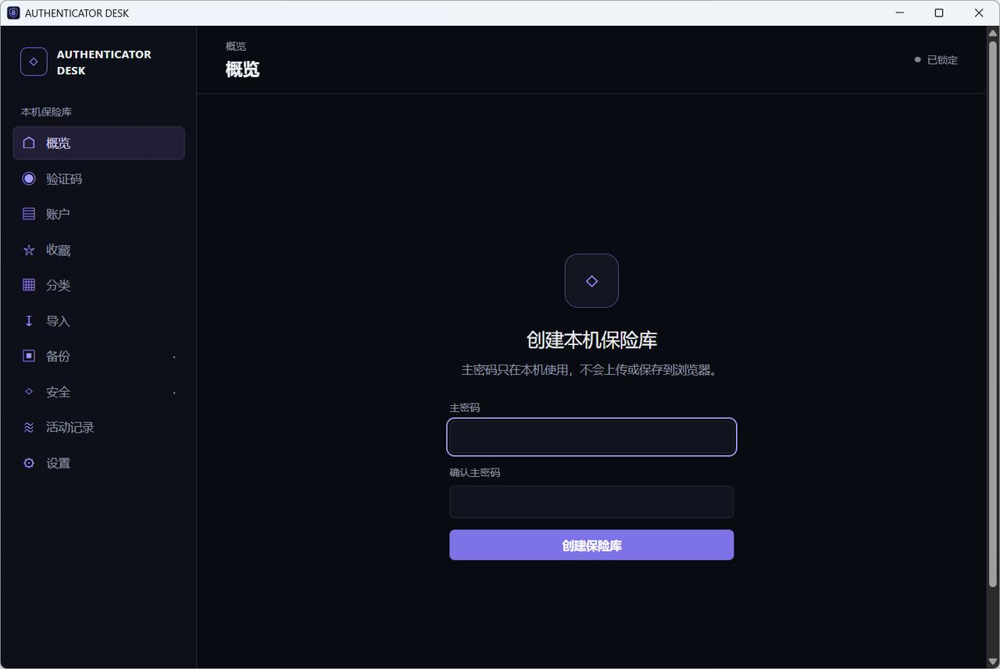</td>
    <td>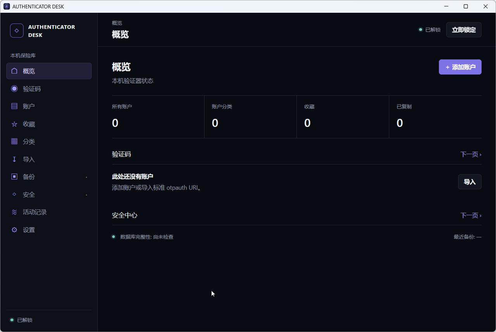</td>
  </tr>
  <tr>
    <td align="center">创建与解锁本地保险库</td>
    <td align="center">账户概览与保险库状态</td>
  </tr>
  <tr>
    <td>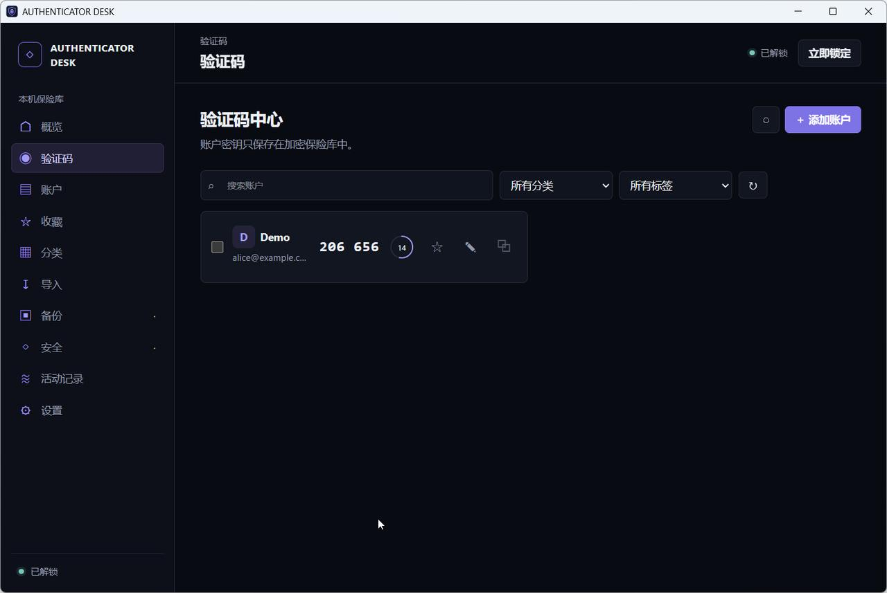</td>
    <td>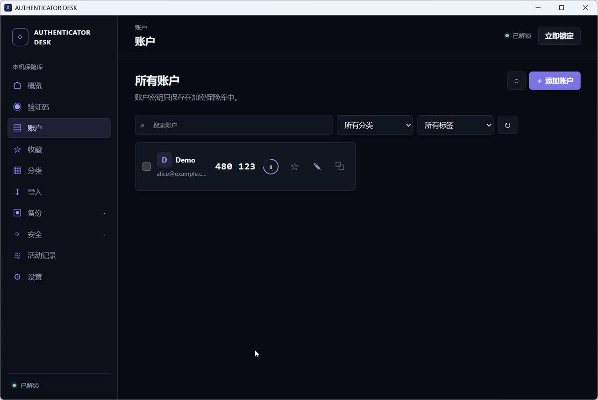</td>
  </tr>
  <tr>
    <td align="center">验证码与倒计时</td>
    <td align="center">账户编辑、收藏与分类</td>
  </tr>
  <tr>
    <td>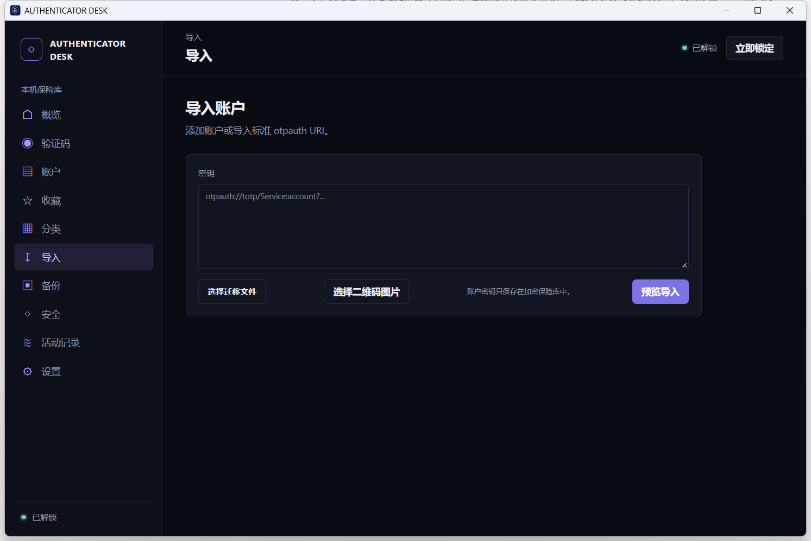</td>
    <td>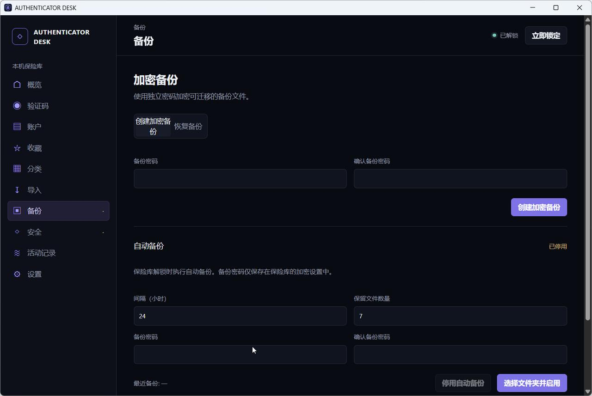</td>
  </tr>
  <tr>
    <td align="center">预览、选择并提交导入</td>
    <td align="center">加密备份与恢复</td>
  </tr>
  <tr>
    <td>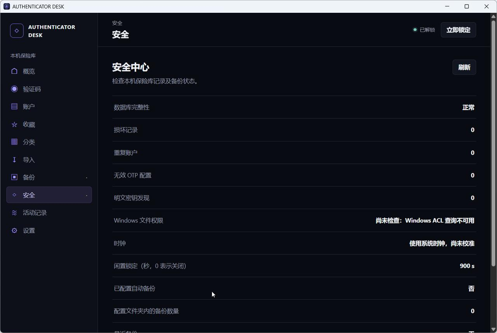</td>
    <td>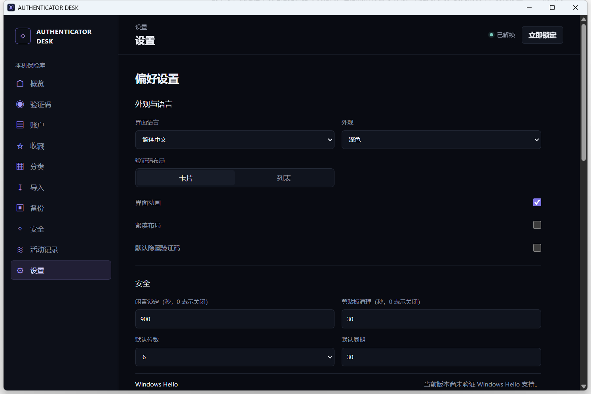</td>
  </tr>
  <tr>
    <td align="center">完整性与配置检查</td>
    <td align="center">语言、外观与桌面偏好</td>
  </tr>
  <tr>
    <td>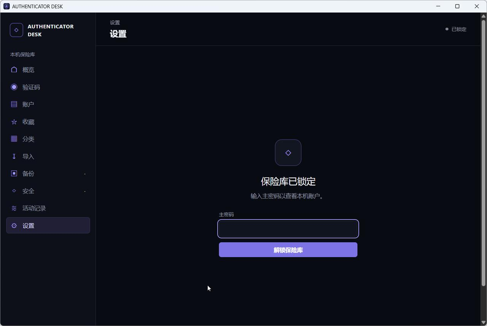</td>
    <td>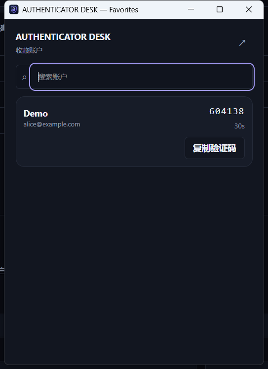</td>
  </tr>
  <tr>
    <td align="center">锁定后隐藏敏感信息</td>
    <td align="center">独立收藏快捷面板</td>
  </tr>
</table>

## 功能

### 保险库与账户管理

- 创建、解锁、锁定本地加密保险库；恢复能力依赖可验证的备份和可读取的保险库状态，不是任意损坏修复工具。
- 管理平台、账户名、算法、位数、周期、HOTP 计数器、备注、分类、排序和收藏。
- 本机生成 TOTP / HOTP；HOTP 计数器需要显式推进，不与服务器自动同步。
- 支持搜索、分类筛选、批量管理、卡片/列表视图、明暗主题与隐藏验证码。
- 手动锁定、闲置超时和退出会清理会话状态；锁定时丢弃待导入和待恢复的明文预览及缓存验证码。

### 导入与迁移

支持粘贴文本、选择本地文件和选择二维码图片；**没有摄像头扫描**。导入遵循「预览 → 选择 → 事务提交」，只提交仍被标记为 `new` 的有效行。

| 格式 | 状态 |
|---|---|
| `otpauth://` 列表，包括 Ente 明文导出 | 支持 |
| Google Authenticator migration URI | 支持 |
| Aegis 明文 JSON | 支持 |
| 2FAS 明文 JSON，schema 1–4 | 支持 |
| andOTP 明文 JSON | 支持 |
| Aegis、2FAS、andOTP、Ente 加密导出 | 识别后以 `unsupported_encrypted_format` 拒绝，不尝试解密 |
| FreeOTP 2.x 序列化/XML 备份 | 识别并拒绝，不绕过 Android Keystore |
| Steam 自定义令牌格式 | 不支持，不转换成普通数字 TOTP |

输入上限为 2 MiB、1,000 行。重复检测结合平台、账户与已解码密钥的指纹。密钥保存在短期 Rust 内存预览中，不随预览结果返回给界面；粘贴文本本身会经过 WebView。详见[迁移格式矩阵](docs/migration-format-matrix.md)。

### 加密备份与恢复

- `.authdesk` 备份使用独立 Argon2id salt 和 AES-256-GCM 加密。
- 恢复先验证并预览，显式选择合并或替换；替换需要再次确认。
- Windows 自动备份使用加密的归属清单管理保留策略，只清理可证明属于本保险库的文件，不随意删除手工备份或其他文件。
- **备份密码丢失即无法恢复**，没有恢复密钥、托管服务或密码重置入口。
- 升级前保留已知可恢复的备份并退出旧版；不要把正向读取旧备份理解为旧版一定能读取新版自动备份元数据。
- FAT32、exFAT 和网络文件系统的发布/清理行为未完成验收，不承诺任意文件系统都适用。

### Windows 桌面集成

`desktop` feature 提供托盘、全局快捷键、独立收藏快捷面板、开机启动、通知、原生文件选择和剪贴板归属保护。托盘点击、快捷键冲突、登录启动、系统通知和系统剪贴板仍需按实际环境完成独立验收，不能以合同测试代替。

浏览器开发壳会明确报告原生安全后端不可用。完整保险库、Tauri IPC 与 Windows 集成需运行 `pnpm tauri dev` 或使用桌面安装包。

## 快速使用

1. 从[发布页](https://github.com/yuchen0x1/authenticator-desk/releases/latest)下载 Windows x64 安装包；升级时保持相同安装包类型。
2. 首次启动创建保险库并设置主密码。没有公开演示账户或通用默认密码。
3. 手动添加账户，或在「导入」中粘贴 URI / 选择文件 / 选择二维码图片；核对预览后再提交。
4. 在验证码或账户页面查看和复制验证码；HOTP 仅在需要时推进计数器。
5. 在「备份」中创建加密备份，并妥善保管备份密码。
6. 在「设置」中选择界面语言、明暗主题、闲置锁定时间和剪贴板清理时间。

TOTP 依赖本机系统时钟；时间不准确可能导致验证码无法使用。请勿将真实密钥、二维码、保险库或备份上传到 Issue。

## 安全模型与限制

- **Rust 负责核心数据**：读写 SQLite、派生密钥、加解密记录、解析导入、生成备份。
- **Argon2id + AES-256-GCM**：记录 ID 作为附加认证数据，敏感密钥和解密缓冲区使用零化类型。
- **前端不持久化秘密**：不保存主密码、派生密钥、OTP seed 或明文备份；手输密码、手输密钥和粘贴导入会短暂经过 WebView，不能宣传“秘密从不经过前端”。
- **剪贴板只清理应用拥有的值**：不会擦掉后来由用户复制的新内容；Windows 剪贴板历史、云同步副本与已失陷操作系统不在保证范围内。
- **更新检查由用户发起**：访问 GitHub HTTPS，不上传保险库内容；安装前验证哈希和配置的更新签名。

必须明确的边界：

- **仍有 1 项开放依赖告警**：Linux GTK 间接依赖 `glib 0.18.5` 存在 `RUSTSEC-2024-0429`，受当前上游版本约束阻塞。它不在 Windows x64 目标依赖图中，但不能据此把锁文件告警当作已修复；详见[已知限制](docs/known-limitations.md#open-dependency-security-advisory)。
- v0.3.1 官方 EXE / MSI 的 Windows Authenticode 状态为 **`NotSigned`**。Minisign/updater 签名不等于 Windows 发布者证书。
- Windows Hello、摄像头扫码、加密第三方备份解密、云同步、密码恢复均不是当前已实现能力。
- 操作系统或调试器已控制解锁进程时，开源、加密和代码混淆都不能保证明文不可见。
- Linux/macOS 当前只验证可移植核心，不宣称完整原生桌面支持。
- 真实旧版自动签名升级、MSI 旧版升级、Windows ACL 和完整原生交互需要各自证据。

详见[安全模型](docs/security-model.md)、[已知限制](docs/known-limitations.md)与[按日期记录的测试报告](docs/test-report.md)。

## 架构

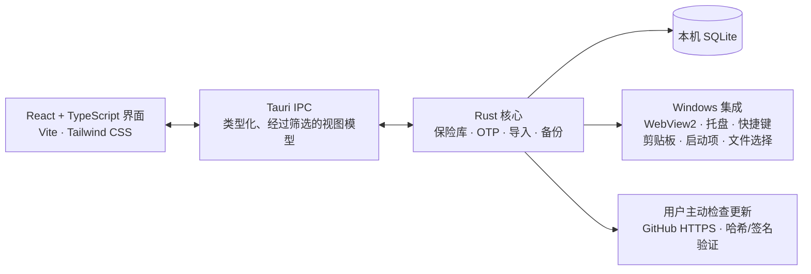

正常部署没有应用服务器。默认 Rust features 不链接桌面运行时，便于测试可移植核心；`desktop` 链接原生桌面功能，`signed-updater` 进一步启用签名更新逻辑。

## 技术栈

| 层 | 技术 | 版本 / 用途 |
|---|---|---|
| 桌面壳 | Tauri | Rust 2.12.6；JS API / CLI 2.12.5 |
| 界面 | React / React DOM | 19.3.1 |
| 前端工具链 | Vite / TypeScript / Tailwind CSS | 8.3.8 / 7.0.2 / 4.3.5 |
| 原生核心 | Rust | 1.99.1，edition 2024 |
| 本机存储 | `rusqlite` / bundled SQLite | schema 1 |
| 密码学 | Argon2id / AES-GCM / HMAC / `zeroize` | 保险库、备份与 OTP |
| 测试 | Vitest / Testing Library / Rust / Node test runner | 5.1.0 / 16.3.3 / `cargo test` / `node --test` |
| 包管理 | pnpm | 11.20.0 |

依赖的准确信息以 `package.json`、`pnpm-lock.yaml`、`src-tauri/Cargo.toml` 和 `rust-toolchain.toml` 为准。

## 下载、校验与升级

[v0.3.1 发布页](https://github.com/yuchen0x1/authenticator-desk/releases/tag/v0.3.1)包含 7 个资产：两个安装包、两个 `.sig`、`release-assets.json`、`SHA256SUMS.txt` 与 `update.json`。

- 根据现有安装选择 NSIS `.exe` 或 MSI，升级时保持同一类型。
- 校验 `SHA256SUMS.txt`；具备 Minisign 验证条件时，进一步核验 detached signatures。
- 备份保险库，完全退出所有旧版进程，包括托盘实例，再安装。
- 发布后记录包含隔离环境中真实的 v0.1.0 → v0.3.1 **手动 NSIS 升级**及原保险库重新打开；这不等于自动 updater 安装或旧版 MSI 升级已经通过。
- 失败时保留原数据和备份，参考[更新与恢复指南](docs/updating.md)，不要删除活动实例的 `.lock` 文件。

## 开发环境

### 前置条件

- Windows 11 x64（原生桌面开发与验收目标）。
- Node.js 26.13.1、pnpm 11.20.0。
- Rust 1.99.1 / MSVC 工具链。
- Visual Studio 2022 C++ Build Tools。
- Microsoft Edge WebView2 Runtime。

按照 [pnpm 安装指南](https://pnpm.io/installation)安装 pnpm 11.20.0。Node.js 26 不默认捆绑 Corepack；若选用 Corepack，需先单独安装并配置，不要假定 `corepack` 命令已存在。Rust 工具链由 `rust-toolchain.toml` 固定。

### 安装与启动

```powershell
pnpm install --frozen-lockfile

# 仅前端开发壳：没有原生保险库/安全后端
pnpm dev

# 原生 Tauri/WebView2 应用
pnpm tauri dev
```

隔离测试可在启动前将 `AUTHDESK_DATA_DIR` 指向临时目录。不要指向生产保险库，不要为了绕过其他进程而删除其活动 `.lock` sidecar。

### 验证命令

```powershell
pnpm exec vitest run
node --test scripts/*.test.mjs
pnpm exec tsc --noEmit
pnpm build

cargo test --locked --manifest-path src-tauri/Cargo.toml
cargo test --locked --manifest-path src-tauri/Cargo.toml --features desktop --test desktop
cargo check --locked --manifest-path src-tauri/Cargo.toml --features signed-updater --bin authenticator-desk
```

真实签名资产校验需要相应密钥、公钥与已构建资产，不能以 mock 替代。测试报告区分已发布版本、本地维护工作树、未签名产物与未验收项，不把某一工作树的通过结果当作现有安装包已更新。

## 文档索引

以下深度文档主要为英文；README 的四种语言版本不意味着所有文档已经翻译。

| 文档 | 内容 |
|---|---|
| [安全模型](docs/security-model.md) | 密码学、信任边界、锁定、导入、备份与网络 |
| [迁移格式矩阵](docs/migration-format-matrix.md) | 支持/拒绝格式、字段约定、输入限制与 fixture 来源 |
| [更新与恢复](docs/updating.md) | 下载、签名、回退与恢复 |
| [已知限制](docs/known-limitations.md) | 未实现或未完成验收的事项 |
| [测试报告](docs/test-report.md) | 按日期区分本地、CI、打包、发布和升级证据 |
| [维护记录](docs/maintenance.md) | 平台目标与发布门槛 |
| [发布历史](docs/releases/release-notes.md) | 历史变更 |
| [v0.3.1 说明](docs/releases/v0.3.1.md) | 当前发布版本的兼容性与边界 |
| [生态研究](docs/research/ecosystem.md) | 观察与后续工作 |
| [贡献指南](CONTRIBUTING.md) | 分支、PR 与贡献流程 |
| [安全报告](SECURITY.md) | 私密漏洞报告要求 |

## 项目状态与后续工作

**现有能力**：本机加密保险库、TOTP/HOTP、预览式导入、加密备份恢复、Windows 打包、四种界面语言。Ubuntu/macOS CI 针对 portable core；Windows CI 包含前端、Rust、安装包与安装生命周期门槛。

**需要独立验收**：真实旧版自动签名更新及回退、Windows 发布者证书、ACL、系统剪贴板历史/云行为、完整原生交互与非 NTFS 存储行为。

**不作当前支持承诺**：Linux/macOS 桌面分发、Windows Hello、摄像头捕获、加密第三方导入解密、浏览器/PWA/服务端托管保险库、密码恢复服务。

路线图以可验证的边界为准，不将候选、本地修复或测试代码直接包装成已发布功能。

## 贡献与安全反馈

从 `main` 创建短期分支并提交 Pull Request。迁移保持旧数据兼容，测试使用合成凭据，用户可见改动补充发布说明。CI 的具体门槛见 [`.github/workflows/ci.yml`](.github/workflows/ci.yml)。

不要在 Issue 或 PR 中上传保险库、备份、密码、二维码、OTP seed、签名密钥或生产 token。漏洞请通过 [GitHub 私密漏洞报告](https://github.com/yuchen0x1/authenticator-desk/security/advisories/new)提交，并遵守 [SECURITY.md](SECURITY.md)。

## 许可证

项目源码使用 [MIT License](LICENSE)。捆绑和传递依赖保留各自许可证与声明。

<p align="center">
  <strong>验证码留在本机，恢复路径明确可控。</strong>
  <br />
  为希望自己掌控第二因素的用户而构建。
</p>
