[简体中文](README.md) | **[繁體中文](README.zh-TW.md)（目前）** | [English](README.en.md) | [日本語](README.ja.md)

<p align="center">
  
</p>

<h1 align="center">AUTHENTICATOR DESK</h1>

<p align="center">
  以離線使用為優先的 Windows 桌面驗證器，可產生 TOTP 與 HOTP 驗證碼。
  <br />
  把保險庫留在本機，清楚界定信任範圍。
</p>

<p align="center">
  <a href="https://github.com/yuchen0x1/authenticator-desk/releases/latest"></a>
  <a href="https://github.com/yuchen0x1/authenticator-desk/actions/workflows/ci.yml"></a>
  <a href="LICENSE"></a>
  <a href="https://github.com/yuchen0x1/authenticator-desk/stargazers"></a>
  <a href="https://github.com/yuchen0x1/authenticator-desk/network/members"></a>
</p>

<p align="center">
  <a href="https://github.com/yuchen0x1/authenticator-desk/releases/latest">下載最新 Windows 發行版本</a>
  ·
  <a href="docs/security-model.md">安全模型</a>
  ·
  <a href="docs/test-report.md">驗證紀錄</a>
  ·
  <a href="https://github.com/yuchen0x1/authenticator-desk/issues">問題回報</a>
</p>

> **本原始碼版本：v0.3.2** · [發行說明](docs/releases/v0.3.2.md)
> Windows 安裝程式的公開狀態以 [GitHub 最新發行頁面](https://github.com/yuchen0x1/authenticator-desk/releases/latest)為準。原始碼版本號不代表對應的安裝程式已發行或已通過簽章驗證。

## 為什麼選擇 AUTHENTICATOR DESK？

如果您想把雙因素驗證帳戶留在自己掌控的裝置，而不交給代管服務，AUTHENTICATOR DESK 就是為此設計的。應用程式使用本機加密保險庫，不需要註冊雲端帳戶，也不監聽區域網路連線，也沒有 HTTP API、資料庫伺服器或訂閱後端。保險庫與密碼學作業由 Rust 核心掌管；React 介面透過 Tauri IPC 取得有明確型別、已去除敏感資訊的檢視模型。

- **本機優先：** 加密的 SQLite 保險庫存放於 Tauri 的應用程式資料目錄。
- **遵循標準：** TOTP 與 HOTP 符合 RFC 6238 與 RFC 4226 的測試向量，支援 HMAC-SHA1、SHA-256 及 SHA-512。
- **流程可查：** 匯入、備份還原、安全檢查及發行版本驗證都有明確流程，不會在背景不透明地執行。
- **以 Windows 為主：** 原生桌面版的驗收目標是搭配 WebView2 的 Windows 11 x64；CI 也會在 Linux 和 macOS 執行可攜式 Rust 核心測試，但不代表這兩個系統已支援完整的原生桌面功能。
- **四種介面語言：** 可在設定中選擇简体中文、繁體中文、English 或日本語。README 的語言切換與應用程式設定互相獨立。

## 介面導覽

以下是儲存庫既有的實際介面截圖，使用測試資料或空白的本機保險庫，並非這次文件更新重新擷取的畫面。截圖不含真實帳戶資料，也不能證明目前的簽署狀態、安裝程式或所有桌面操作已通過驗收。

若要切換應用程式語言，請前往 **設定 → 外觀與語言 → 介面語言**（英文介面為 **Settings → Appearance and language → Language**），選擇简体中文、繁體中文、English 或日本語後儲存。部分介面文字可能尚未翻譯。

<table>
  <tr>
    <td>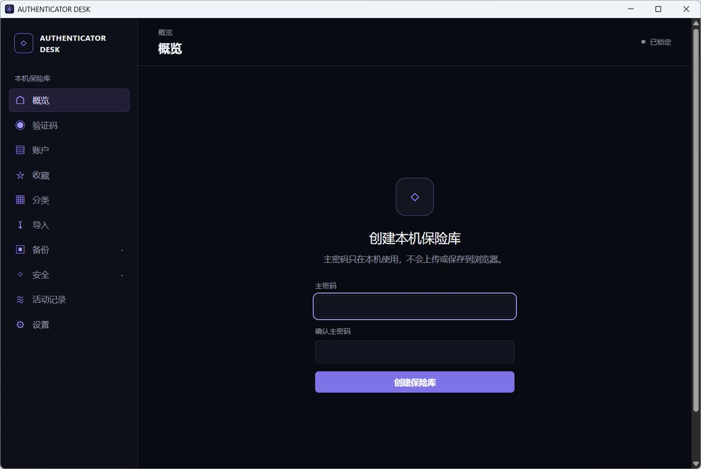</td>
    <td>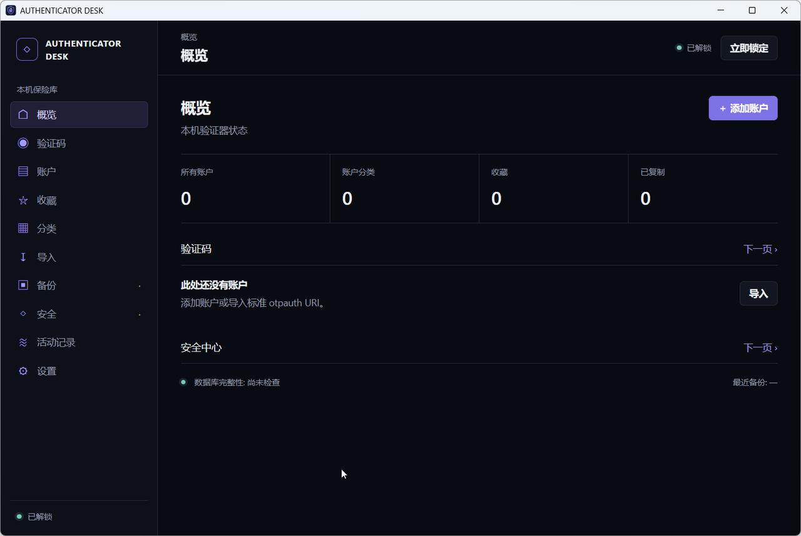</td>
  </tr>
  <tr>
    <td align="center">建立或解鎖本機保險庫</td>
    <td align="center">概覽、帳戶數量與保險庫狀態</td>
  </tr>
  <tr>
    <td>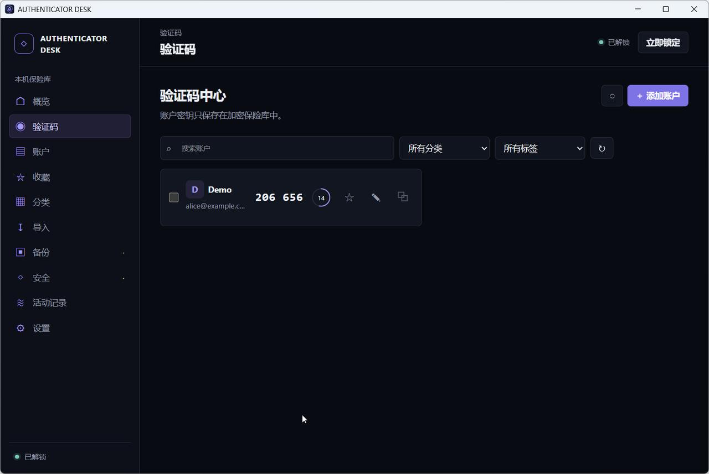</td>
    <td>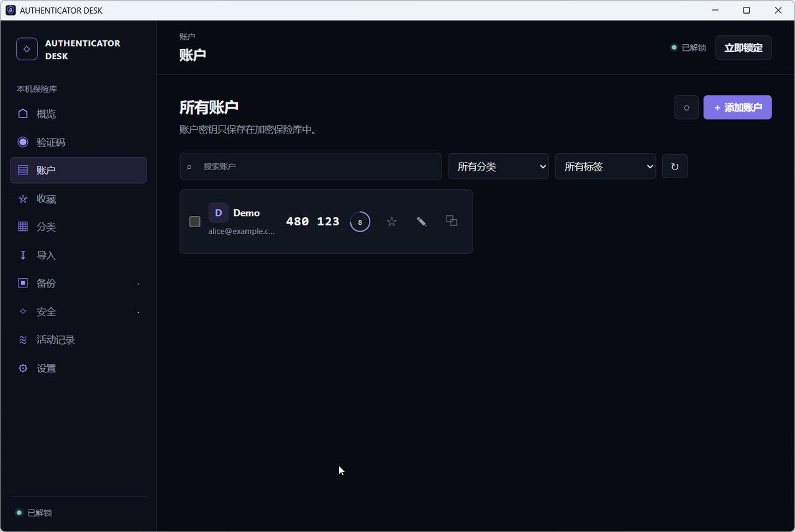</td>
  </tr>
  <tr>
    <td align="center">即時 TOTP/HOTP 驗證碼與倒數計時</td>
    <td align="center">編輯帳戶、收藏與分類</td>
  </tr>
  <tr>
    <td>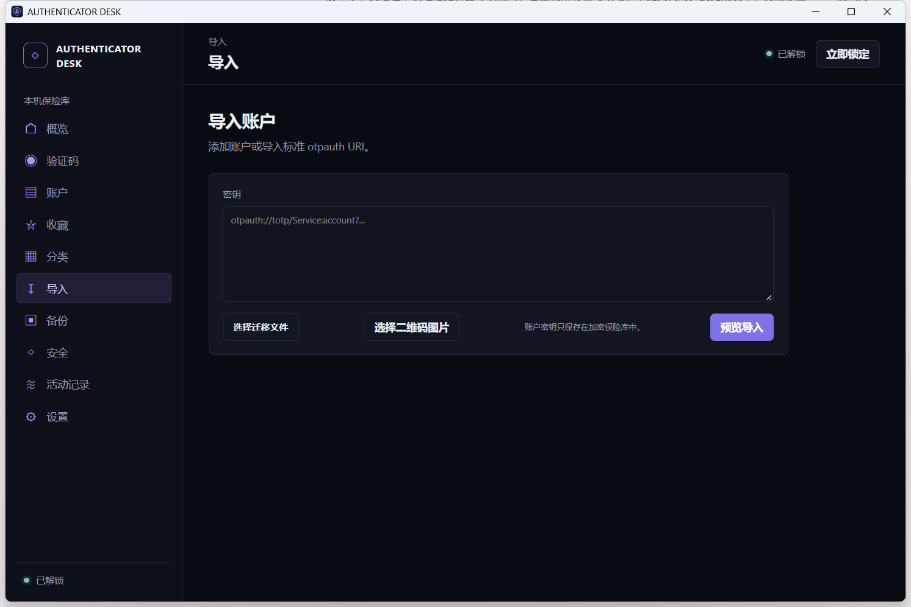</td>
    <td>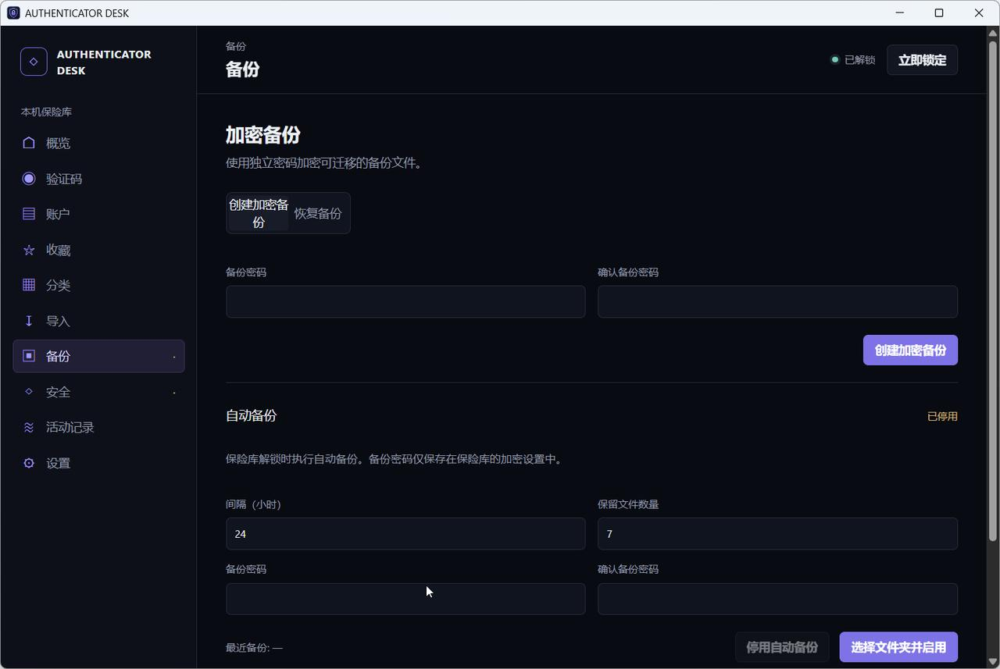</td>
  </tr>
  <tr>
    <td align="center">預覽、選取並確認匯入</td>
    <td align="center">加密備份與還原</td>
  </tr>
  <tr>
    <td>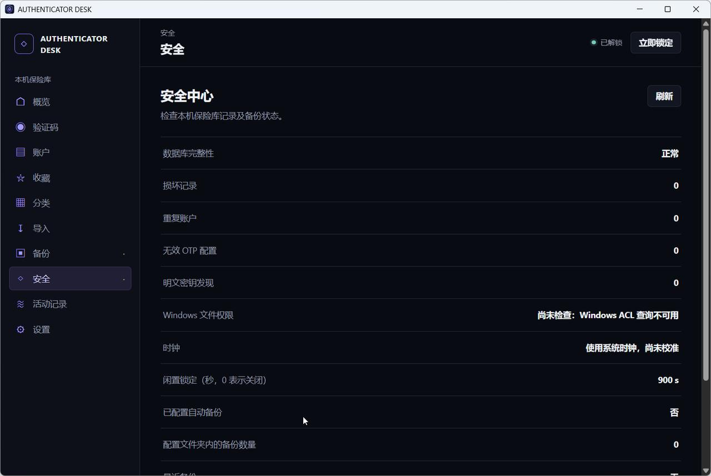</td>
    <td>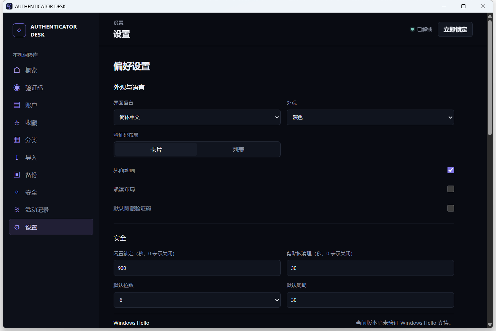</td>
  </tr>
  <tr>
    <td align="center">完整性與設定檢查</td>
    <td align="center">鎖定、閒置逾時及桌面偏好設定</td>
  </tr>
  <tr>
    <td>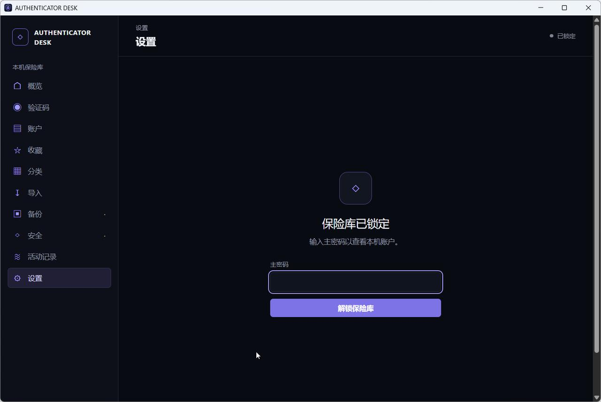</td>
    <td>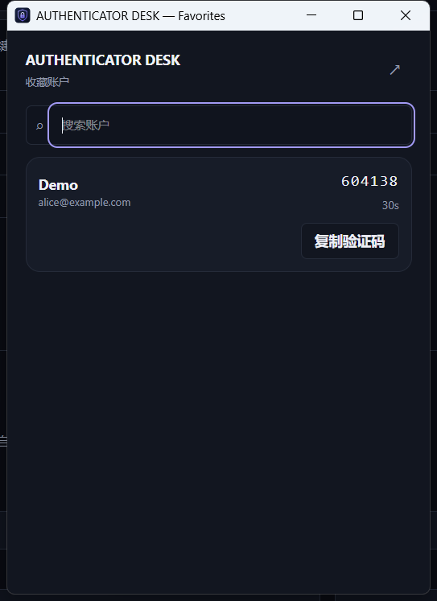</td>
  </tr>
  <tr>
    <td align="center">保險庫已鎖定，解鎖後即可檢視帳戶</td>
    <td align="center">從快速面板存取收藏帳戶</td>
  </tr>
</table>

## 功能

### 保險庫與帳戶管理

- 建立、解鎖、鎖定及還原加密的本機保險庫。還原仰賴可驗證的備份或可讀取的保險庫狀態，並非能修復任何損壞的工具。
- 儲存帳戶的發行者、帳戶名稱、演算法、位數、週期、HOTP 計數器、備註、分類、排序及收藏狀態。
- 在本機產生 TOTP 與 HOTP 驗證碼。必須主動操作才會遞增 HOTP 計數器，且操作可稽核，不會與伺服器自動同步。
- 支援搜尋、分類篩選、批次管理、卡片／清單檢視，以及淺色與深色主題。
- 保險庫鎖定或啟用隱藏驗證碼設定時，不顯示驗證碼，也無法複製。
- 可手動鎖定，也會在閒置逾時或程序結束時鎖定。鎖定時會清除待處理的匯入、還原預覽與快取的驗證碼，並在檢查剪貼簿所有權後解除持有狀態。

### 匯入與移轉

貼上文字、開啟本機檔案或匯入 QR 圖片，皆採用先預覽、再寫入的流程。**不支援相機掃描。** Rust 讀取程式會在寫入保險庫前逐筆分類，只有仍標示為 `new` 的有效項目能透過交易寫入。

| 格式 | 支援狀態 |
|---|---|
| `otpauth://` 清單，包含 Ente 明文匯出 | 支援 |
| Google Authenticator 移轉 URI | 支援 |
| Aegis 明文 JSON | 支援 |
| 2FAS 明文 JSON，結構版本 1–4 | 支援 |
| andOTP 明文 JSON | 支援 |
| Aegis、2FAS、andOTP 與 Ente 加密匯出 | 偵測後以 `unsupported_encrypted_format` 拒絕，不嘗試解密 |
| FreeOTP 2.x 序列化／XML 備份 | 偵測後拒絕，不會嘗試繞過 Android Keystore 或密碼 |
| Steam 權杖格式 | 回報不支援，不會在未告知的情況下轉為數字型 TOTP |

匯入上限為 2 MiB、1,000 筆。系統以發行者、帳戶及解碼後密鑰的指紋判斷是否重複。匯入的密鑰只會短暫留在 Rust 記憶體中的預覽資料，不會隨預覽結果回傳至介面；保險庫鎖定或修訂版本變更時即清除。不過，貼上的文字本身仍會經過 WebView。欄位規格及測試資料來源請見[移轉格式對照表](docs/migration-format-matrix.md)。

### 備份與還原

- 以密碼加密 `.authdesk` 備份，使用獨立的 Argon2id 鹽值與 AES-256-GCM 加密。
- 還原前先驗證並預覽，明確選擇合併或取代。寫入前會檢查衝突數量及資料結構限制；取代還需要再次確認。
- Windows 上的自動備份使用保險庫專用的加密所有權清單管理保留原則。只清理能證明屬於該保險庫的檔案，不會任意刪除手動備份或其他檔案。
- **遺失備份密碼就無法還原該備份。** 沒有復原金鑰、代管復原服務或密碼重設入口。
- 升級前請保留已知可還原的備份，並完全結束舊版程式。新版能讀取舊備份，不代表舊版一定能讀取新版的自動備份中繼資料。
- FAT32、exFAT 及網路檔案系統的備份檔案發布與清理行為尚未完成驗收，不保證所有檔案系統都適用。

### Windows 桌面整合

`desktop` 功能提供瀏覽器介面所沒有的原生整合：

- 系統匣操作，以及可存取收藏帳戶的快速面板；
- 全域快捷鍵，包括快速存取收藏帳戶的驗證碼；
- 隨 Windows 啟動及傳送測試通知；
- 選取檔案與 QR 圖片的原生對話框；
- 清除剪貼簿前會檢查所有權，不會清掉使用者稍後才複製的內容。

系統匣點擊、快捷鍵衝突、登入時啟動、系統通知及系統剪貼簿，仍須在實際環境中分別驗收，不能以介面規格測試取代。

瀏覽器介面可供前端開發使用，但會明確提示桌面安全後端無法使用。若要使用完整保險庫、Tauri IPC 與 Windows 整合，請執行 `pnpm tauri dev` 或安裝桌面版。

## 快速開始

1. 從[發行頁面](https://github.com/yuchen0x1/authenticator-desk/releases/latest)下載 Windows x64 安裝程式。升級時請沿用同一類型。
2. 首次啟動時建立保險庫並設定主密碼。沒有公開示範帳戶或通用的預設密碼。
3. 手動新增帳戶，或在「匯入」中貼上 URI、選擇檔案或 QR 圖片；核對預覽後再確認匯入。
4. 在驗證碼或帳戶頁面檢視及複製驗證碼，僅在需要時遞增 HOTP 計數器。
5. 在「備份」中建立加密備份，並妥善保管備份密碼。
6. 在「設定」中選擇介面語言、淺色／深色主題、閒置鎖定時間及剪貼簿清除時間。

TOTP 仰賴本機系統時鐘；時間不準確可能導致驗證碼無法使用。請勿將真實密鑰、QR Code、保險庫或備份上傳至 Issue。

## 安全模型與限制

安全邊界明確限定於本機：

- 只有 Rust 核心會讀取 SQLite、衍生金鑰、加密或解密記錄、解析匯入資料，以及寫入備份。
- 保險庫金鑰由 Argon2id 衍生，記錄以 AES-256-GCM 加密。記錄 ID 以附加驗證資料的方式繫結；OTP 密鑰與解密後的緩衝區使用可歸零清除的型別。
- 前端不會持久儲存主密碼、衍生金鑰、OTP 種子或明文備份。不過，手動輸入的密碼與密鑰，以及貼上的匯入文字，會短暫經過 WebView，不能宣稱秘密從不經過前端。錯誤只回傳固定的代碼及不洩漏敏感資訊的訊息，不回傳 SQL、路徑或密鑰等資料。
- 只有在應用程式仍持有剪貼簿所有權，且其中的內容與程式原先寫入的完全相符時，才會清除。Windows 剪貼簿歷程記錄、雲端同步，以及作業系統遭入侵的情形均不在此保證範圍內。
- 更新檢查由使用者主動發起，透過 HTTPS 連線至 GitHub，不會傳送保險庫內容。安裝前會依雜湊值及已設定的分離式簽章原則驗證更新檔案。

重要限制：

- 本專案是開放原始碼的本機軟體。作業系統遭入侵或有偵錯器介入時，程式碼混淆無法保護已解鎖的保險庫。
- 刻意不支援第三方加密匯出格式，不會嘗試猜測如何解密。
- 已發行的 v0.3.1 安裝程式，其 Authenticode 狀態為 **`NotSigned`**。更新程式所使用的 Minisign 簽章用於驗證發行檔案的完整性，並非 Windows 發行者憑證。
- **仍有 1 項未解決的相依套件安全告警：** Linux GTK 的間接相依套件 `glib 0.18.5` 涉及 `RUSTSEC-2024-0429`。它不在 Windows x64 目標的相依關係圖中，但鎖定檔案中的告警尚未修復，仍待上游處理。請參閱[未解決的相依套件安全告警](docs/known-limitations.md#open-dependency-security-advisory)。
- macOS 核心 CI 曾有一次密碼輪替測試失敗；加入診斷資訊後未再發生，根因仍未確認，不能視為正式環境的修正。
- Windows 11 x64 是原生桌面版的驗收目標。Linux 與 macOS 的 CI 驗證的是可攜式核心，而不是完整的原生桌面體驗。
- Windows Hello、相機擷取、第三方加密備份解密、雲端同步及密碼復原不是目前已實作的功能。發行者簽署、排除剪貼簿歷程記錄及雲端同步、從舊版執行實際的簽章自動更新與回復、MSI 舊版升級、Windows ACL 檢查及完整原生操作，均需另行驗收。請參閱[已知限制](docs/known-limitations.md)與[測試報告](docs/test-report.md)。

## 架構

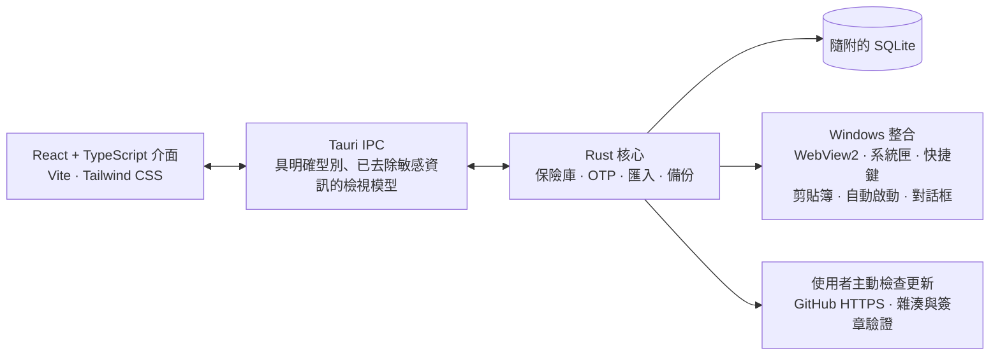

一般部署不需要應用程式伺服器。`desktop` 功能會連結原生 Tauri 整合元件，`signed-updater` 則進一步啟用簽章更新邏輯。Rust 的預設功能集無須連結桌面執行環境，即可測試可攜式核心。

## 技術堆疊

| 層級 | 技術 | 版本／用途 |
|---|---|---|
| 桌面框架 | Tauri | Rust crate 2.12.6；JS API 與 CLI 2.12.5 |
| 前端 | React、React DOM | 19.3.1 |
| 前端工具鏈 | Vite、TypeScript、Tailwind CSS | 8.3.8 · 7.0.2 · 4.3.5 |
| 原生核心 | Rust | 工具鏈 1.99.1，edition 2024 |
| 本機儲存 | 透過 `rusqlite` 使用 SQLite | 隨附 SQLite；結構版本 1 |
| 密碼學 | Argon2id、AES-GCM、HMAC-SHA1/256/512、`zeroize` | 保險庫、備份與 OTP 作業 |
| 測試 | Vitest、Testing Library、Rust 測試、Node 測試執行器 | 5.1.0 · 16.3.3 · `cargo test` · `node --test` |
| 套件管理工具 | pnpm | 11.20.0 |

相依套件版本以 `package.json`、`pnpm-lock.yaml`、`src-tauri/Cargo.toml` 和 `rust-toolchain.toml` 為準。此表僅供概覽，不能取代鎖定檔案。

## 下載與升級

請從 [GitHub 最新發行頁面](https://github.com/yuchen0x1/authenticator-desk/releases/latest)下載已公開的 Windows x64 安裝程式：

- 選擇 NSIS（`.exe`）或 MSI 安裝程式。
- 升級時請沿用同一類型的安裝程式。
- 請驗證 `SHA256SUMS.txt` 中的總和檢查碼；若您的流程支援 Minisign，也請驗證分離式 `.sig` 檔案。
- 安裝前請備份保險庫，並完全結束所有執行中的用戶端程式。

[歷史測試報告](docs/test-report.md)記錄了 v0.3.1 下載檔案的獨立驗證，以及在隔離環境中從 v0.1.0 **以 NSIS 手動升級**至 v0.3.1 並重新開啟原有保險庫的結果。這些紀錄不代表 v0.3.2 已通過驗證，也不能證明自動更新安裝或 MSI 舊版升級已通過驗收。

## 開發環境

### 先決條件

- Windows 11 x64，用於原生桌面開發及驗收測試；
- Node.js 26.13.1 與 pnpm 11.20.0；
- Rust 1.99.1，搭配 MSVC 工具鏈；
- Visual Studio 2022 C++ Build Tools；
- Microsoft Edge WebView2 Runtime。

此儲存庫以 `rust-toolchain.toml` 鎖定 Rust 工具鏈版本，並以 `package.json` 鎖定套件管理工具版本。

### 安裝與執行

請先依 [pnpm 官方安裝指南](https://pnpm.io/installation)安裝 pnpm 11.20.0，再以 `pnpm --version` 確認版本。Node.js 26 不一定隨附 Corepack。若選用 Corepack，請依指南另外安裝；採用其他安裝方式則不需要 Corepack。

```powershell
pnpm install --frozen-lockfile

# 瀏覽器介面：僅供前端開發，無法使用原生保險庫與安全後端。
pnpm dev

# 原生應用程式：使用 Tauri IPC 與 Windows 整合功能。
pnpm tauri dev
```

若測試時需要乾淨且隔離的保險庫，請在啟動原生應用程式前，將 `AUTHDESK_DATA_DIR` 設為暫存目錄。請勿指向正式使用的保險庫，也不要為了繞過其他程序的鎖定而刪除使用中的 `.lock` 輔助檔案。

### 驗證指令

```powershell
# 前端與發行規格檢查
pnpm exec vitest run
node --test scripts/*.test.mjs
pnpm exec tsc --noEmit
pnpm build

# 可攜式 Rust 核心與原生功能規格檢查
cargo test --locked --manifest-path src-tauri/Cargo.toml
cargo test --locked --manifest-path src-tauri/Cargo.toml --features desktop --test desktop
cargo check --locked --manifest-path src-tauri/Cargo.toml --features signed-updater --bin authenticator-desk
```

待發行的簽署產物必須使用實際發行金鑰產生的檔案來驗證，不能以模擬資料代替。解讀本機測試結果前，請先閱讀[有日期的測試報告](docs/test-report.md)。報告區分已發行版本的驗證紀錄、本機維護檢查、未簽署的產物與尚未驗收的項目。

## 文件索引

以下深入文件主要使用英文。介面與 README 提供四種語言，不代表所有文件都已翻譯。

| 文件 | 用途 |
|---|---|
| [安全模型](docs/security-model.md) | 保險庫的信任邊界、密碼學、鎖定流程、匯入、備份及網路行為 |
| [移轉格式對照表](docs/migration-format-matrix.md) | 支援與拒絕的格式、欄位規格、限制及測試資料來源 |
| [更新與復原](docs/updating.md) | 尋找發行版本、檢查簽章及雜湊值、回復舊版與復原流程 |
| [已知限制](docs/known-limitations.md) | 本發行版本未宣稱支援的項目 |
| [測試報告](docs/test-report.md) | 附日期的本機測試、託管 CI、打包、發行及升級驗證紀錄 |
| [維護紀錄](docs/maintenance.md) | 平台選擇與發行驗收條件 |
| [發行歷程](docs/releases/release-notes.md) | 已發行及候選版本的說明 |
| [v0.3.2 發行說明](docs/releases/v0.3.2.md) | 多語言與維護修補；發行須通過安全檢查、前端與 Rust 測試、Windows 打包、NSIS 與 MSI 各自的安裝生命週期檢查，以及實際更新簽章驗證 |
| [v0.3.1 發行說明](docs/releases/v0.3.1.md) | 歷史版本的相容性與驗證範圍 |
| [研究與待辦事項](docs/research/ecosystem.md) | 驗證器生態觀察與後續工作 |
| [參與貢獻](CONTRIBUTING.md) | 分支、Pull Request 與發行的貢獻流程 |
| [安全通報](SECURITY.md) | 私下通報漏洞的規則 |

## 專案現況與後續規劃

### 支援範圍及現有驗證紀錄

- 原生桌面版以 Windows 11 x64 為目標，並提供 NSIS 與 MSI 安裝套件。
- 本機加密保險庫、TOTP/HOTP 驗證碼產生、匯入預覽與寫入，以及加密備份與還原。
- 在 Ubuntu 與 macOS 上透過 CI 測試可攜式 Rust 核心。
- v0.3.1 已發行；發行檔案經獨立驗證，並有隔離環境下的 NSIS 手動升級紀錄。

### 尚待驗收

- 發行後的本機維護變更與不再更動的 v0.3.1 發行檔案分開管理。
- 簽章自動更新的安裝及回復舊版，需要在乾淨的執行環境中，使用實際發行金鑰及舊版另行驗證。
- Windows 發行者身分、ACL 檢查、剪貼簿歷程記錄與雲端同步行為，以及完整的原生容錯能力，都需要獨立的驗收紀錄。

### 目前未宣稱支援

- Linux 或 macOS 原生桌面版；
- Windows Hello、相機擷取或還原第三方加密匯入資料；
- 瀏覽器、PWA 或伺服器代管的保險庫；
- Authenticode 發行者簽署；
- 密碼復原或復原金鑰服務。

專案傾向維持較小、且有驗證紀錄可佐證的支援範圍。若要提出平台功能需求，請先參閱[維護決策](docs/maintenance.md)。

## 參與貢獻與安全通報

請從 `main` 建立短期分支並開啟 Pull Request。保險庫移轉必須與現有資料相容，測試時請使用虛構的憑證資料，並在相關發行說明中記錄使用者可見的變更。CI 涵蓋可攜式 Rust 核心、前端、Windows 打包及安裝程式生命週期檢查；實際流程請見 [`.github/workflows/ci.yml`](.github/workflows/ci.yml)。

請勿在 Issue 或 Pull Request 中附上保險庫資料庫、備份檔案、密碼、QR Code、OTP 種子、簽署金鑰或正式環境的權杖。發現漏洞時，請透過 [GitHub 私密漏洞通報](https://github.com/yuchen0x1/authenticator-desk/security/advisories/new)回報，並遵循 [SECURITY.md](SECURITY.md)。

## 授權

AUTHENTICATOR DESK 採用 [MIT 授權條款](LICENSE)。該授權適用於本儲存庫；隨附及間接相依套件仍適用其各自的授權與聲明。

<p align="center">
  <strong>把保險庫留在本機，也要清楚知道如何還原。</strong>
  <br />
  為希望自行掌控第二道驗證的人而設計。
</p>
